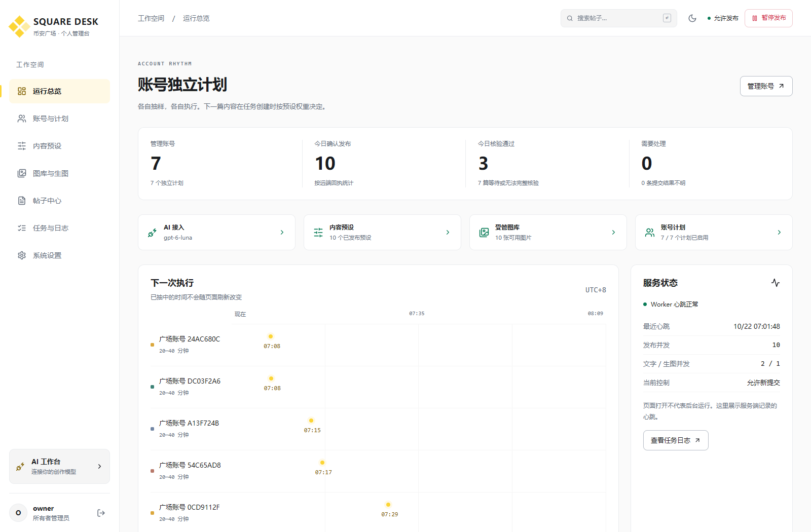
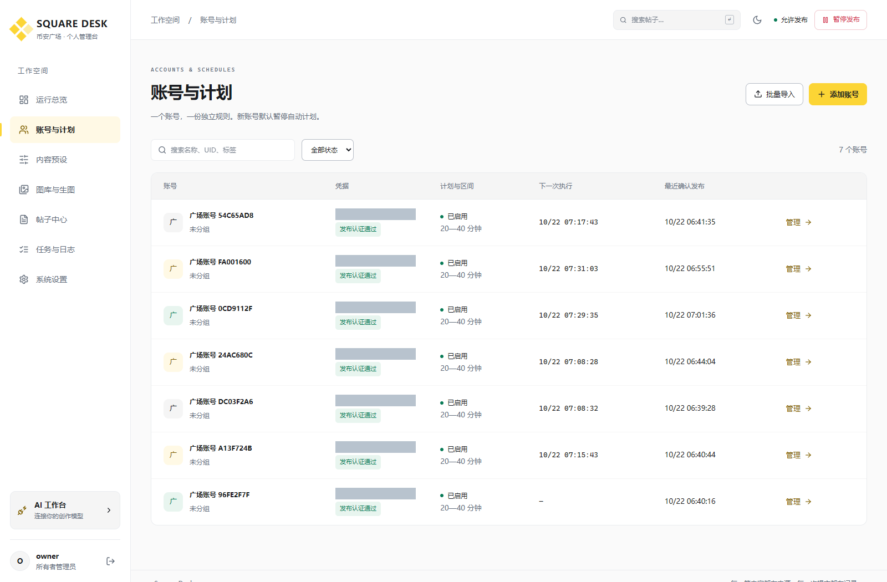
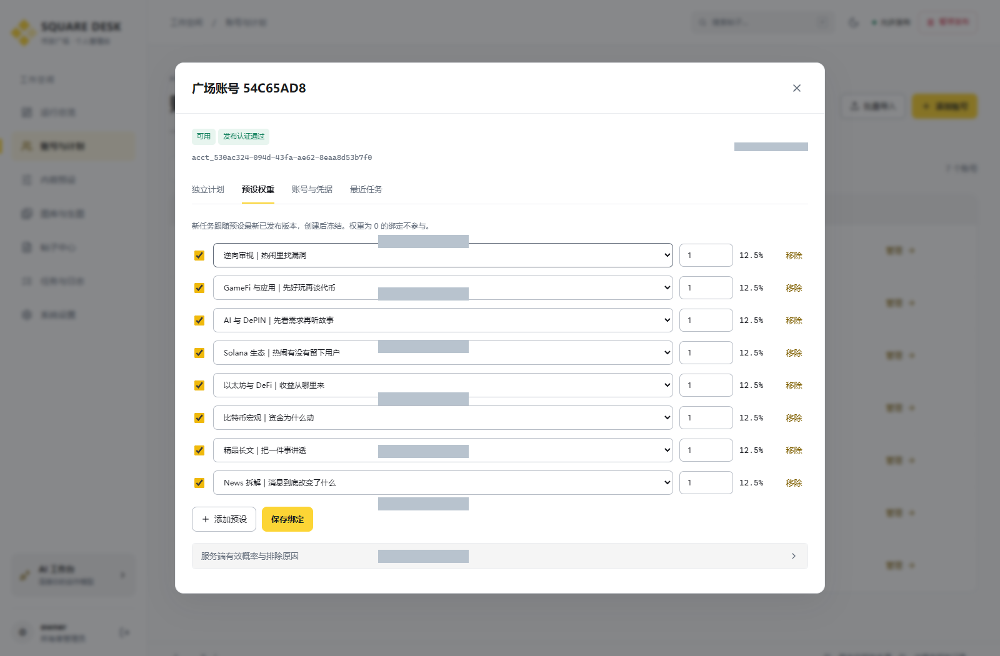
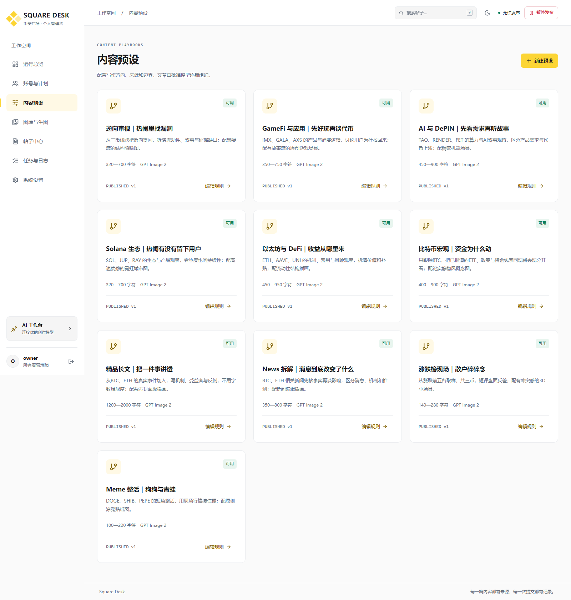
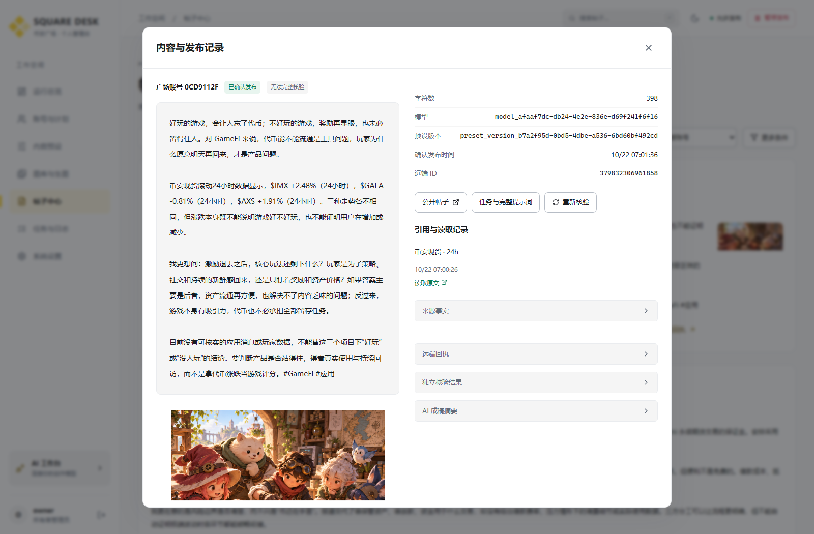
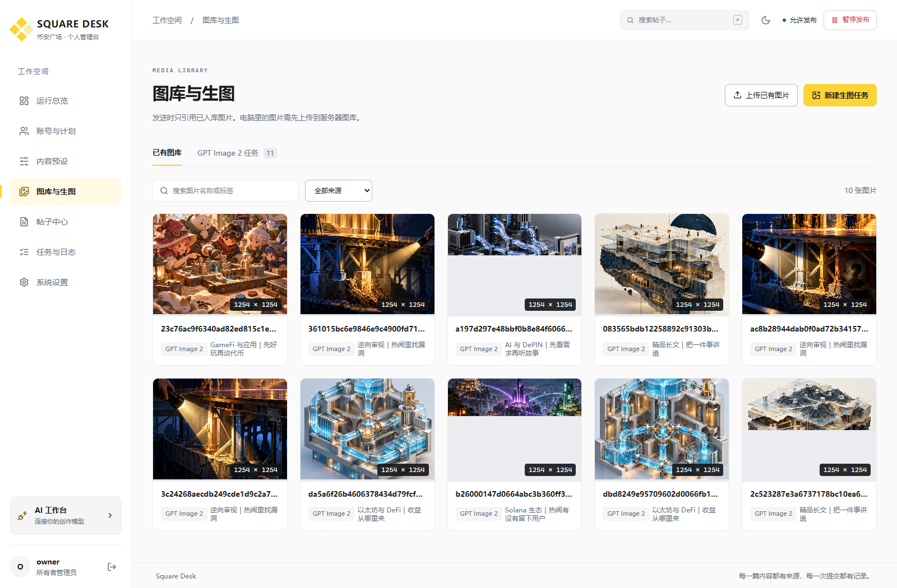
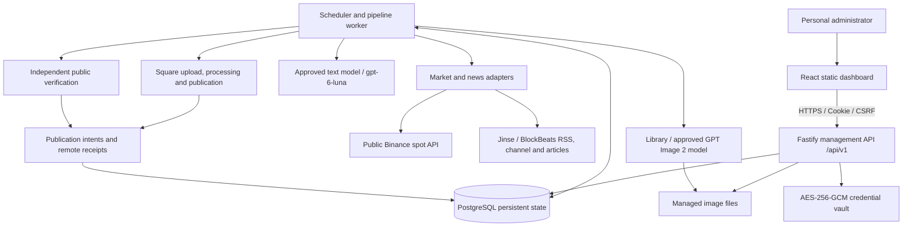
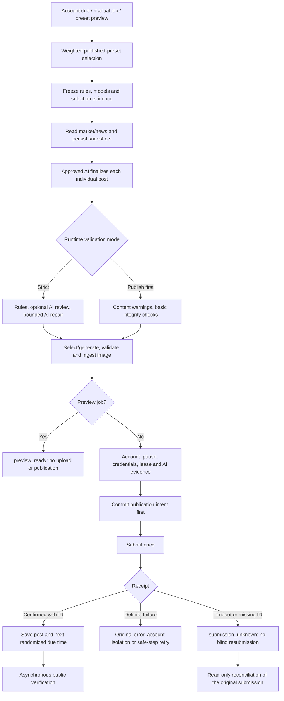
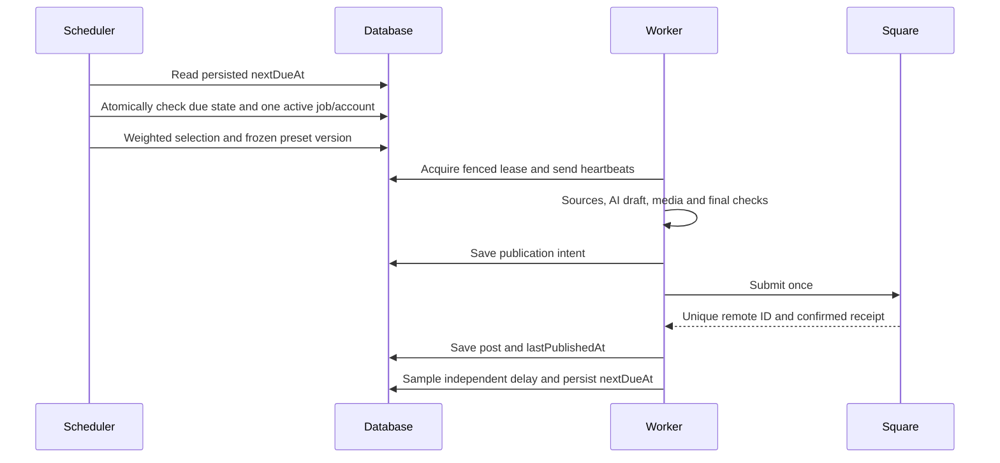
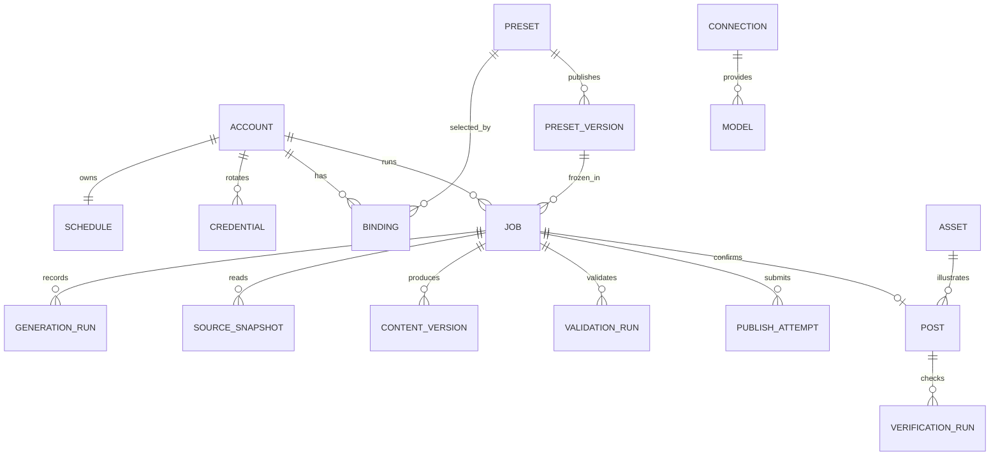

# Square Desk · Binance Square Multi-account AI Publishing Platform

[中文](README.md) · **English** · [20 product screenshots](docs/product/README.md) · [Requirements and constraints](docs/README.md) · [Deployment](app/deployment/README.md)

Square Desk manages multiple Binance Square accounts belonging to one owner. Its browser dashboard configures accounts, AI models, content presets, news and market sources, images, and independent randomized schedules. The server generates text and images, publishes posts, retains receipts, and verifies public content. Schedules continue after the browser closes.

This monorepo includes the frontend, backend, database schema, ten writing/image presets, native deployment tools, earlier CLI workflows, and the complete requirements and operating constraints. **Every publishable body must be finalized by an explicitly approved AI model. There is no local-template fallback.**



> Documentation baseline: October 22, 2026, Asia/Taipei. Application packages: `0.2.0`. Recorded production release: `20261022-publish-first`. Screenshots show the actual deployed product on that date; counters are capture-time observations. Credential display areas are masked. Real keys, administrator passwords, databases, and operational batches are excluded from Git.

## Contents

[Modules](#modules-and-product-screenshots) · [Architecture](#architecture) · [Stack and layout](#stack-and-repository-layout) · [Publishing pipeline](#ai-content-and-publishing-pipeline) · [Scheduling](#independent-randomized-scheduling) · [Sources](#news-and-market-sources) · [Presets](#ten-content-and-image-presets) · [Validation](#validation-modes) · [Data and API](#data-model-and-api) · [Local setup](#local-setup-and-development) · [Deployment](#remote-deployment-and-operations) · [Verification](#tests-and-documentation-verification) · [Constraints](#constraints-history-and-limits)

## Modules and product screenshots

| Module | Implemented behavior | Frontend / backend entry |
| --- | --- | --- |
| Overview | Account/schedule counts, confirmed versus verified posts, next-run timeline, worker heartbeat, capacity and readiness | `main.tsx` / `overview.ts` |
| Accounts and schedules | Individual accounts, key-only bulk import, deduplication, key rotation, archiving, separate random intervals, weighted presets | `pages/accounts.tsx` / `control.ts` |
| Content presets | Direction, tone, length, tokens, tags, sources, models, images, draft rules and immutable published versions | `pages/presets.tsx` / `rules.ts` |
| Library and images | Local uploads, collections/style/tag search, approved image jobs, real file ingestion and provenance | `pages/content.tsx` / `media.ts` |
| Post center | Combined search by body, account, token, preset/version, model, source, time, remote ID, publication and verification status | `pages/content.tsx` / `queries.ts` |
| Jobs and logs | Actual complete prompts, frozen rules, model requests/outputs, validation rounds, events, intents, receipts and reconciliation | `pages/content.tsx` / `pipeline.ts` |
| AI integration | Custom gateways, multiple protocols, model discovery and approval, text/image defaults, connection capacity | `pages/ai-settings.tsx` / `ai-routes.ts` |
| News and market sources | Jinse, BlockBeats, Binance spot data, real reads, filters, evidence, caching and fallback transports | `pages/source-settings.tsx` / `sources.ts` |
| Administration | Global pause, concurrency, leases, retries, validation mode, password changes and audit records | `pages/settings.tsx` / `server.ts` |

Entries are relative to [frontend src](app/square-dashboard/src) and [backend src](app/square-service/src).

### Accounts, weights and presets







### Published content, images and sources






See the [complete product gallery](docs/product/README.md) for login, editors, image rules, post search, job logs, AI connections, runtime controls, dark mode and mobile layouts. The current product UI is Chinese; this guide documents its behavior in English.

## Architecture



The management API and worker share application services and persistent state. Both can run in one Node process; native PostgreSQL also supports separate workers. PGlite is the single-process development/test option. Production runs under native systemd, without Docker, WSL or local virtualization.

The recorded deployment serves the static frontend at `bn.sid.mom` and the API at `bn-api.sid.mom`, forwarding to port `39410`. The browser receives the public API origin and session, while the backend encrypts and uses model/Square credentials. Browsers do not call publication or model services directly.

## Stack and repository layout

| Layer | Technology |
| --- | --- |
| Frontend | React 19, TypeScript 5.9, Vite 7, Lucide, native CSS, responsive light/dark themes |
| API | Node.js ≥ 22.14, Fastify 5, Zod 4, session cookies, CSRF, exact-origin CORS |
| Persistence | Native PostgreSQL; PGlite for development/tests; SQL/JSONB, versions, transactions and leases |
| AI and sources | Undici, Cheerio, protocol adapters, immutable source snapshots, prompt/output evidence |
| Images | Sharp, file/dimension/aspect validation, SHA-256, model and provenance records |
| Operations | Node Test Runner, Playwright, Python/Paramiko, systemd, Nginx |

```text
binance-square-query-sender/
├── README.md / README.en.md          Complete bilingual guides
├── AGENTS.md                        Repository and runtime constraints
├── app/
│   ├── square-dashboard/            React pages, components, browser tests
│   ├── square-service/
│   │   ├── src/                     API, scheduling, AI, sources, media, publication
│   │   ├── database/                Database SQL
│   │   ├── scripts/                 Initialization, migration, isolated workbench
│   │   └── tests/                   Backend integration/regression coverage
│   ├── content-presets/             Ten presets, builders and validation
│   ├── deployment/                  Native releases, SSH, diagnostics, screenshots
│   ├── repository/                  Repository checks and diagram generation
│   └── src/                         Earlier standalone publisher
├── docs/                            Requirements, architecture, API, acceptance, operations
│   ├── product/                     Actual product screenshots, manifest, diagrams
│   └── legacy/                      Archived earlier batch workflow
├── .agents/skills/binance-square-posts/  Local publishing skill and source rules
├── vendor/square-post/               Upstream scripts used by the earlier workflow
├── market.mjs / square-batch.mjs     Earlier batch and verification tools
├── tests/                           Earlier tool tests
└── .github/workflows/ci.yml          Native checks, builds and tests
```

Applications retain separate lockfiles. The root is not an npm workspace; its scripts orchestrate component commands. All source files are tracked directly, with no submodules or embedded Git links.

## AI content and publishing pipeline



### Explicit models and AI evidence

Create a connection, discover/register and approve specific models, then select defaults or bind a preset. The base URL includes the version prefix; the adapter appends the protocol path. Model parameters cannot override messages, system instructions or the actual model identity.

| Protocol | Text path relative to base URL | Images |
| --- | --- | --- |
| `openai_chat_images` | `chat/completions` | Images supported |
| `openai_responses_images` | `responses` | Images supported |
| `anthropic_messages` | `messages` | No image generation |
| Approved GPT Image 2 generation | `images/generations` | Actual file ingestion required |

For example, base URL `http://127.0.0.1:18241/v1` produces Chat requests to `http://127.0.0.1:18241/v1/chat/completions`. The colon before the port is required. Here, loopback refers to the **API server**, not the administrator's computer.

The recorded production gateway uses `gpt-6-luna` for text and `gpt-image-2.5` for images. These are configured gateway IDs, not a claim that every provider offers those names. Changing connections requires explicit discovery/approval, without silent downgrade.

Each generation stores the rendered complete prompt and version, request URL, requested/reported model IDs, output, usage, content hash and frozen rules. Repair includes the previous text and structured token/news evidence, and remains model-authored. The job's actual-prompt view exposes what was sent without authentication headers.

### Image provenance

Only managed library images or approved GPT Image 2 job outputs are publishable. The service reads the real file, validates type/dimensions/aspect ratio/hash, records provenance and ingests it first. Presets choose library, generation or mixed selection and define empty-library/failure handling. All ten bundled presets request a fresh image per article and block on failure rather than substitute a placeholder.

## Independent randomized scheduling



Each account samples integer seconds from the inclusive interval `[minIntervalSeconds, maxIntervalSeconds]`, persisting `anchorAt`, `sampledDelaySeconds` and `nextDueAt`. Page refreshes do not resample. Restarts use durable state. Resume and resample operations have defined semantics and audit trails. There is no single shared 15-minute broadcast timer.

Preset probability is `preset weight / sum of currently eligible weights`. Disabled presets, unpublished rules and unavailable candidates are excluded; the UI shows effective probabilities and exclusion reasons. Tasks freeze the selected rules/model version, so later edits affect future tasks.

Only one active publication pipeline runs per account. Account failures are isolated; overall job, text and image capacity are independent. Uncertain outcomes retain the original intent and cannot be blindly replayed through a restart or another button click.

## News and market sources

| Source | Reading logic | Evidence and limits |
| --- | --- | --- |
| Binance spot | Exchange metadata plus rolling 24h statistics; active, spot-enabled USDT pairs with nonzero turnover; official data-host fallback | Token, signed percentage, window and fetch time; ranking presets take the top five on both sides |
| Jinse | Public flash-news API with full body, timestamp and source link; topic/alias/token filters | Titles or search snippets are not treated as verified full articles |
| BlockBeats | Official RSS, with official public-channel/article fallbacks | Actual evidence URL, body and publication time; degraded transport remains visible |
| Article reader | Allowed-host article extraction, removing navigation and unrelated text | Unreadable material is not fabricated; required-source failures remain explicit |

Concurrent reads are coalesced and cached with persisted failure evidence, without presenting stale data as a fresh successful read. Jobs retain immutable snapshots. Writing distinguishes proposals, consideration, testing, approval and implementation; simultaneous price moves do not establish causality.

Presets control freshness, required/optional sources, token counts, fixed versus ranking selection, and whether every token needs a percentage. The current pack generally uses a 15-minute market window and 72-hour news window; News and long-form presets require related BlockBeats material. Publish-first mode does not invent missing sources, but it avoids repeatedly rewriting solely because image preparation caused a freshness warning.

## Ten content and image presets

| # | Preset | Preferred characters / maximum | Dedicated image direction |
| --- | --- | --- | --- |
| 1 | Meme: dogs and frogs | 100–180 / 220 | Original frog/dog doodle stickers |
| 2 | Gainers/losers: retail commentary | 140–230 / 280 | Three-token 3D miniature stage |
| 3 | News: what the event changes | 350–650 / 800 | Paper, lens and editorial collage |
| 4 | Long-form: explain one issue fully | 1200–1800 / 2000 | Graphite, glass and handmade-paper feature art |
| 5 | Bitcoin macro and capital flows | 400–700 / 900 | Copper discs, streams and valves |
| 6 | Ethereum/DeFi: where yield comes from | 450–750 / 950 | Pipes, reservoirs and safety-valve cutaway |
| 7 | Solana: activity versus retained users | 320–550 / 700 | Purple/green network city with visible use |
| 8 | AI/DePIN: demand before narrative | 450–700 / 900 | Computing modules and productive workbench |
| 9 | GameFi/apps: product before tokens | 350–600 / 750 | Original characters solving a tabletop mechanism |
| 10 | Contrarian: questions behind the hype | 320–550 / 700 | Stage facade and its supporting structures |

The portable [presets.json](app/content-presets/presets.json) contains full writing/image instructions. [Preset documentation](docs/14-ten-content-presets.md) describes model bindings, news requirements and import behavior. Character counting uses Unicode code points including tags, punctuation, whitespace and newlines. The platform does not impose the earlier universal 200-character rule.

## Validation modes

| Behavior | `strict` | `publish_first` |
| --- | --- | --- |
| Approved AI evidence, nonempty body, matching hash, hard character limit | Required | Required |
| Tags, market claims, news evidence/date/progress metadata | Blocking errors; bounded AI repair | Nonblocking warnings |
| Banned words and historical similarity | Validated | Warnings retained |
| Optional AI semantic review | Per preset | Not called |
| Freshness and pre-submission content refresh | Strict gate | Warnings, avoiding rewrite loops |
| Image provenance/readability/hash, account, credentials, lease, duplicate prevention | Enforced | Enforced |

New installations default to strict mode. The recorded production configuration uses publish-first at the owner's request. Change it under **系统设置 → 运行控制 → 内容校验模式**. This does not change generation presets or bypass actual authentication, rate limits or platform rejection. Validation history remains visible; see [the validation change record](docs/17-publication-validation-and-priority.md).

## Data model and API



This diagram shows business relationships, not a claim that every line has a SQL foreign key. Fixed tables use SQL/JSONB records with `id/data/version/created_at/updated_at`; transactions protect leases, versions and publication intents.

Routes use `/api/v1`. Protected operations require an administrator session; writes also validate Origin and CSRF. Configuration changes use `expectedVersion` to prevent concurrent overwrites.

| Resource | Representative endpoints |
| --- | --- |
| Authentication/runtime | `POST /auth/login`, `GET /auth/me`, `GET /health`, `GET/PATCH /runtime`, `GET /overview` |
| Accounts | `GET/POST /accounts`, `POST /accounts/import`, `PATCH /accounts/:id`, credential rotation/verification |
| Bindings/schedules | `GET/PUT /accounts/:id/preset-bindings`, `GET/PUT /accounts/:id/schedule`, pause/resume/resample |
| Presets | `GET/POST /presets`, `PATCH /presets/:id`, `POST /presets/:id/publish-version`, `POST /presets/:id/preview` |
| Images | `GET /assets`, `POST /assets/upload`, `GET /assets/:id/content`, `GET/POST /image-jobs` |
| Publication jobs | `POST /accounts/:id/publications`, `GET /publication-jobs/:id`, cancel/safe retry/reconcile |
| Content/posts | `GET /generation-runs/:id`, `GET /posts`, `GET /posts/:id`, `POST /posts/:id/verify` |
| Settings | `/model-connections`, `/models`, `/ai/settings`, `/data-sources`, `/audit-events` |

There is no arbitrary-text direct-send endpoint. Preview may incur real model/image charges but never publishes. See the [API contract](docs/06-api-contract.md); the [backend routes](app/square-service/src/server.ts) define current behavior.

## Local setup and development

### Install

Use native Git, Node.js ≥ 22.14 and npm. Deployment helpers additionally need Python 3/Paramiko. Production uses PostgreSQL; single-process development can use PGlite. No Docker or WSL is required.

```bash
git clone git@github.com:wikigsroom/binance-square-query-sender.git
cd binance-square-query-sender
npm ci
npm ci --prefix app/square-service
npm ci --prefix app/square-dashboard
```

The original Windows working copy is `C:\dev\sandbox\binance square`. Copy `app/square-service/.env.example` to `.env` in the same directory. Configure a 32-byte base64 `ENCRYPTION_KEY` and an `ADMIN_PASSWORD` of at least 12 characters; the default username is `owner`. For development, leave `DATABASE_URL` blank, set `PUBLIC_ORIGIN=http://localhost:4300`, and use API port `4310`.

```bash
# Keep the generated key only in the ignored local .env.
node -e "console.log(require('crypto').randomBytes(32).toString('base64'))"
cd app/square-service
npm run init
npm run dev
```

In another terminal:

```bash
cd app/square-dashboard
npm run dev
```

Open `http://localhost:4300`; the development proxy targets `127.0.0.1:4310`. Initialization runs once, refuses to overwrite an administrator and does not enable real publishing.

| Variable | Meaning |
| --- | --- |
| `ENCRYPTION_KEY` | 32-byte base64 credential master key; back up with the database |
| `DATABASE_URL` / `DATA_DIR` | PostgreSQL or development PGlite; managed file/image directory |
| `HOST` / `PORT` | API bind address and port |
| `PUBLIC_ORIGIN` | Exact dashboard origin, including scheme and port |
| `COOKIE_SECURE` | `true` for production HTTPS; `false` for local HTTP |
| `RUN_WORKER` | In-process worker by default; set API to `false` for a separate-worker setup |
| `SQUARE_PUBLISH_ENABLED` | Real publication transport; new environments default to `false` |
| `OUTBOUND_PROXY_URL` | Optional outbound proxy without changing the system proxy |
| `IMPORT_ROOTS` | Semicolon-separated permitted legacy image roots; disabled by default |
| `WEB_DIR` | Optional frontend build served directly by the API |

Configure model credentials through the dashboard; never put them in frontend `app-config.js`. First-time order: **AI connections/approved models → sources → published preset versions → library/images → accounts and weights → random intervals → enable schedules**. Real delivery also requires the global pause to be off, transport enabled, and valid account/configuration state.

### Isolated workbench

```bash
# Terminal A: synthetic local model/news responses, real publishing hard-disabled
npm --prefix app/square-service run workbench
# Terminal B: frontend proxy targets workbench API 4321
npm --prefix app/square-dashboard run workbench
```

The UI remains at `http://localhost:4300`. **Only this fixture** uses `owner / fixture-password-1234`; it is not a production password. Choose either normal development or workbench mode on these ports. Fixture output is not evidence of real publication.

## Remote deployment and operations

```text
HTTPS bn.sid.mom       -> Nginx static files /www/wwwroot/bn.sid.mom
HTTPS bn-api.sid.mom   -> Nginx proxy -> 127.0.0.1:39410
                                          |
                              square-platform.service
                              API + scheduler + worker
                                  |             |
                              PostgreSQL    DATA_DIR / images
```

The deployed `app-config.js` contains only the public API origin. Preserve `/api/v1/...` when proxying and disable caching for sessions, management requests and protected images. Credentialed CORS uses the exact frontend origin and includes `PUT` preflights. See the [Nginx example](app/deployment/bn-api-proxy.conf.example).

| Location | Recorded production convention |
| --- | --- |
| Static frontend | `/www/wwwroot/bn.sid.mom` |
| Current / release trees | `/opt/square-platform/current` / `/opt/square-platform/releases/<release>/service` |
| Persistent data | `/opt/square-platform/data` |
| Private runtime configuration | `/etc/square-platform/square.env` |
| Native unit | `square-platform.service` |
| PostgreSQL | Dedicated `square_platform` database/role; existing native instance on port `5433` |

```bash
npm run build:platform
python -B app/deployment/package_release.py --release your-release-id
```

Packages contain builds, SQL and lockfiles in ignored `app/deployment/artifacts/`, without live configuration, accounts, databases, secrets or local dependency trees. Read the [native deployment guide](app/deployment/README.md) before using the scripts. Copy the [SSH example](app/deployment/ssh.example.json) and [bootstrap example](app/deployment/bootstrap.example.json) to ignored `.private/` files and fill only those private copies. Install helper dependencies with `python -m pip install -r app/deployment/requirements.txt`.

`install-release.sh` is first-install only and refuses existing resources. `upgrade-release.sh` is the upgrade entry: check active work, back up, validate the archive, switch releases and verify/roll back. Adjust paths, PostgreSQL instance and service dependencies to the target host. Account-enabling, recovery and import scripts change business state; they are not recurring health checks.

```bash
sudo systemctl status square-platform.service --no-pager
sudo journalctl -u square-platform.service -n 100 --no-pager
```

| Symptom | Interpretation and inspection |
| --- | --- |
| Global publishing paused | New scheduling/submission control, not proof the API/worker stopped; account and transport switches are separate |
| AI final-text validation failed | Read validation rounds, tags, source IDs and actual prompts; select the intended mode |
| `MODEL_CAPACITY_WAIT` | Inspect connection capacity and final state; published jobs can retain an earlier wait field |
| 401 / 429 / 5xx | Read original redacted errors; relaxed content checks do not resolve authentication, limits or upstream faults |
| Waiting for an image | Inspect image task, connection capacity and error; the preset may prohibit fallback |
| Confirmed but public verification unavailable | Receipt and public readability are separate; do not resend |
| Cross-origin preset-save error | Check proxy target, exact Origin, cookies, CSRF and PUT preflight |

Back up **the database, managed images and encryption master key together**. A database alone cannot recover encrypted credentials. Do not rebuild or restart unrelated shared PostgreSQL services to troubleshoot this application.

## Tests and documentation verification

```bash
npm run check:platform       # Frontend/backend TypeScript
npm run build:platform       # Production builds
npm test                    # Backend integration/regression + earlier batch tools
npm run test:dashboard       # Starts/stops isolated workbenches; ports 4300/4321 must be free
npm run verify:repository    # Staged files, credentials, nested Git links and documentation links
```

Browser tests use native Chrome/Chromium; set `PLAYWRIGHT_CHROMIUM_EXECUTABLE` when needed. CI runs natively on Ubuntu/Node without production accounts or paid models. Both type checks/builds passed, along with **61 backend, 13 browser and 9 earlier-tool tests: 83 in total**. Details are recorded in [the delivery record](docs/18-repository-delivery.md).

There are **20 actual production screenshots**. Capture blocks API writes other than login/logout, verifies runtime switches were unchanged and closes the browser in `finally`. See the [capture manifest](docs/product/capture-manifest.json) for times, routes, environment and results. To recapture with private administrator configuration, run `npm run capture:product`; override targets with `SQUARE_CAPTURE_ORIGIN` / `SQUARE_CAPTURE_API_ORIGIN`. Capture does not preview, publish, change schedules or request post reverification.

## Constraints, history and limits

- [AGENTS.md](AGENTS.md) defines workspace-only operations, new code in `app/`, documentation in `docs/`, native execution, browser cleanup, AI/media evidence and duplicate prevention.
- [Requirements 00–08](docs/README.md) preserve the original design; records 09–17 describe implementation and production changes. Historical undeployed/paused states are dated observations. Current behavior follows the latest code, documentation and saved settings.
- The [earlier standalone publisher](app/README.md), [archived batch guide](docs/legacy/batch-publisher.md), root CLI tools and local skill remain available. Their fixed 15-minute/three-token/200-character rules do not override platform presets. Never run them beside the platform worker for the same accounts.
- Git excludes real `.env`, `.private/`, `keys.txt`, live account configurations, databases, batches, logs, complete production diagnostics, personal image libraries, dependencies and builds. Cloning does not reveal a production password or automatically start sending.
- This is a single-owner product, not a multi-tenant SaaS. External services can fail; cross-system exactly-once delivery is not assumed. Uncertain submissions retain explicit intent and require read-only reconciliation.
- A confirmed remote receipt and a matched public body/tags/image are separate metrics. Screenshots and historical acceptance do not guarantee future calls will succeed.

Further reading: [documentation index](docs/README.md), [architecture/data](docs/05-architecture-and-data.md), [scheduling](docs/04-account-scheduling.md), [content pipeline](docs/03-content-pipeline.md), [publish-first behavior](docs/17-publication-validation-and-priority.md), [product gallery](docs/product/README.md).
