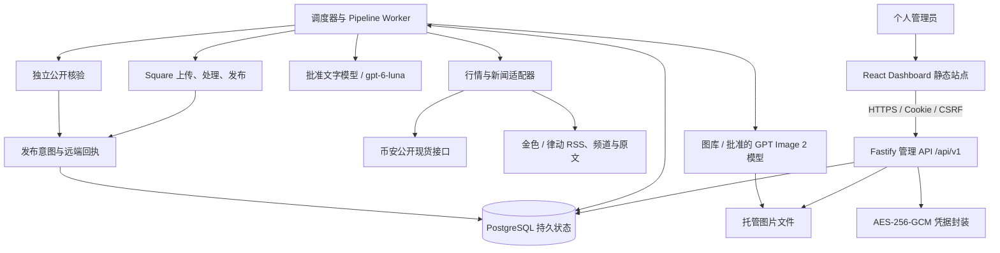
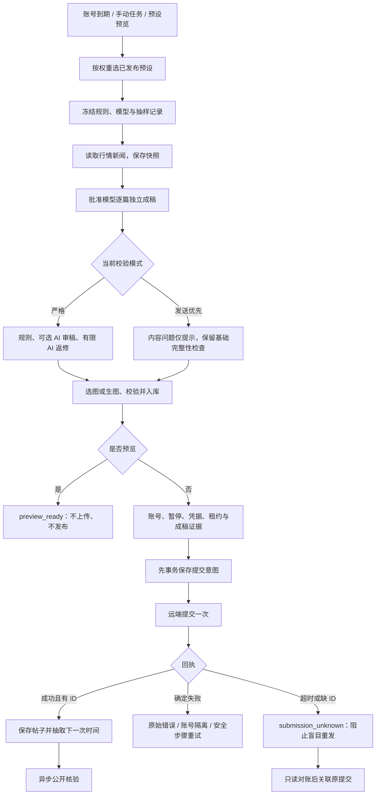
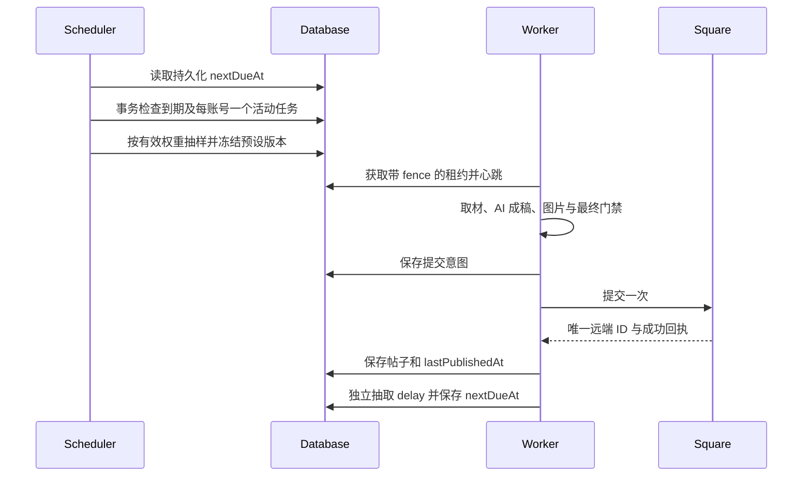
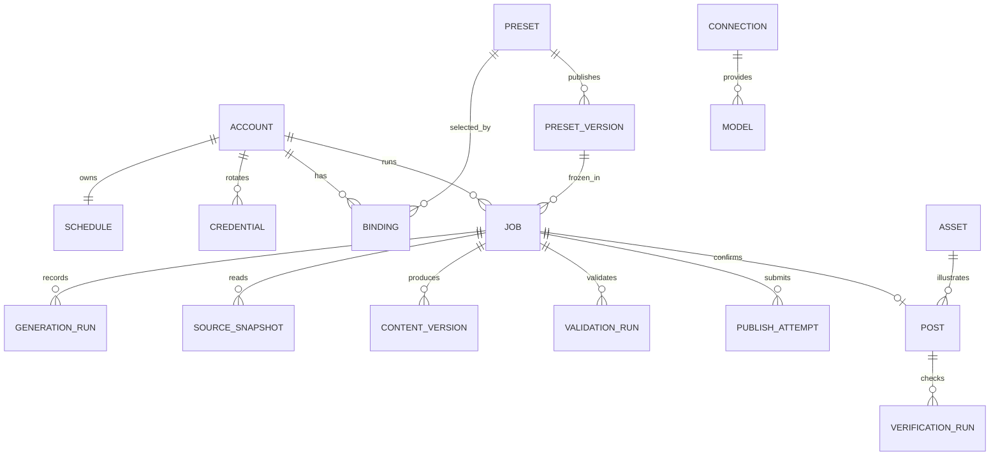

# Square Desk · 币安广场多账号 AI 发布平台

**中文** · [English](README.en.md) · [20 张产品截图](docs/product/README.md) · [需求与约束](docs/README.md) · [部署说明](app/deployment/README.md)

Square Desk 用于管理本人多个 Binance Square 账号。浏览器 Dashboard 管理账号、模型、内容预设、新闻行情、图库和独立随机计划；服务器完成 AI 成稿、生图、发布、回执记录和公开核验。关闭管理页面不影响后台计划。

本仓库统一包含前后端、数据库、十种内容与生图预设、原生部署脚本、早期命令行工具、完整需求及约束文档。**所有发布正文必须经过明确批准的 AI 模型成稿；不会以本地模板替代。**


> 文档基线：2026-10-22；应用包版本 `0.2.0`；记录的生产版本 `20261023-article-body-guard`。截图来自2026-10-22生图策略更新前的真实线上管理台，数字是拍摄时状态。凭据展示区已遮挡；实际密钥、管理员密码、数据库和运行批次不进入仓库。

## 导航

[产品模块](#产品模块与截图) · [整体架构](#整体架构) · [目录](#技术栈与目录) · [发布流水线](#ai-内容生产与发布) · [随机调度](#独立随机调度) · [来源](#新闻与行情来源) · [十种预设](#十种内容与生图预设) · [校验模式](#内容校验模式) · [数据与 API](#数据模型与-api) · [本地启动](#本地安装与开发) · [部署](#远程部署与运维) · [测试](#测试与文档核验) · [约束](#约束历史与边界)

## 产品模块与截图

| 模块 | 已实现能力 | 前端 / 后端入口 |
| --- | --- | --- |
| 运行总览 | 账号/计划、今日确认发布与核验、下一次执行时间轴、Worker 心跳及并发 | `main.tsx` / `overview.ts` |
| 账号与计划 | 单个账号、仅 Key 批量导入、去重、凭据轮换、归档、独立随机区间、多预设权重 | `pages/accounts.tsx` / `control.ts` |
| 内容预设 | 方向、语气、篇幅、选币、标签、来源、模型、配图；草稿和不可变发布版本 | `pages/presets.tsx` / `rules.ts` |
| 图库与生图 | 本地图上传、集合/画风/标签检索、批准模型生图、实际图片入库与来源摘要 | `pages/content.tsx` / `media.ts` |
| 帖子中心 | 正文、账号、代币、预设/版本、模型、来源、时间、远端 ID、发布/核验状态组合搜索 | `pages/content.tsx` / `queries.ts` |
| 任务与日志 | 完整实际提示词、规则快照、请求与输出、逐轮校验、阶段日志、发布意图、回执与对账 | `pages/content.tsx` / `pipeline.ts` |
| AI 接入 | 自定义网关、多协议、模型发现与批准、默认文字/图片模型、连接容量 | `pages/ai-settings.tsx` / `ai-routes.ts` |
| 素材与新闻 | 金色、律动、币安现货的实际读取、筛选、证据、缓存与备用链路 | `pages/source-settings.tsx` / `sources.ts` |
| 运行与管理 | 全局暂停、并发、租约、重试、严格/发送优先、管理员密码与审计 | `pages/settings.tsx` / `server.ts` |

入口分别位于 [前端 src](app/square-dashboard/src) 和 [后端 src](app/square-service/src)。

### 账号、权重与预设


### 发布记录、图片与来源


完整登录、编辑器、配图规则、帖子搜索、任务日志、AI 连接、运行控制、深色主题和移动端截图见 [产品图册](docs/product/README.md)。

## 整体架构



管理 API 与 Worker 共用应用服务和持久数据，可在一个 Node 进程运行；原生 PostgreSQL 支持独立 Worker。PGlite 是单进程开发/测试选项。服务器使用 systemd 管理进程，不依赖容器或本地虚拟化。

当前静态站点为 `bn.sid.mom`，API 为 `bn-api.sid.mom`，后端高端口 `39410`。浏览器只使用会话及公共 API 地址；模型和 Square 凭据由后端加密保存、按任务解密使用。

## 技术栈与目录

| 层 | 技术 |
| --- | --- |
| 前端 | React 19、TypeScript 5.9、Vite 7、Lucide、原生 CSS；响应式、明暗主题 |
| API | Node.js ≥ 22.14、Fastify 5、Zod 4、会话 Cookie、CSRF、精确 Origin CORS |
| 数据 | 原生 PostgreSQL；开发/测试 PGlite；SQL + JSONB、版本号、事务及租约 |
| AI 与来源 | Undici、Cheerio、协议适配、来源快照、提示词与输出证据 |
| 图片 | Sharp；类型/尺寸/比例、SHA-256、来源与模型记录 |
| 验证与部署 | Node Test Runner、Playwright、Python/Paramiko、systemd、Nginx |

```text
binance-square-query-sender/
├── README.md / README.en.md          双语完整指南
├── AGENTS.md                        仓库与运行约束
├── app/
│   ├── square-dashboard/            React 页面、组件、浏览器测试
│   ├── square-service/
│   │   ├── src/                     API、调度、AI、来源、图片、发布
│   │   ├── database/                数据库 SQL
│   │   ├── scripts/                 初始化、旧数据迁移、隔离工作台
│   │   └── tests/                   后端集成/回归
│   ├── content-presets/             十种预设、构建及校验
│   ├── deployment/                  原生部署、SSH、检查、产品截图
│   ├── repository/                  提交检查与图示生成
│   └── src/                         早期独立发布器
├── docs/                            需求、架构、API、验收、运维
│   ├── product/                     真实产品截图、清单、图示
│   └── legacy/                      早期批次流程归档
├── .agents/skills/binance-square-posts/  本地发布技能和取材规范
├── vendor/square-post/               早期使用的上游发布脚本
├── market.mjs / square-batch.mjs     早期批次与核验工具
├── tests/                           早期工具测试
└── .github/workflows/ci.yml          原生检查、构建与测试
```

两个应用保留各自锁文件。根目录不是 npm workspace，根命令编排组件脚本。所有组件直接保存源码，没有 Git 子模块或嵌套 Git 链接。

## AI 内容生产与发布



### 模型请求与成稿证据

先创建连接，再发现/登记并批准具体模型，最后设置默认或绑定预设。连接基础 URL 包含版本路径；按协议追加相对路径，不允许模型参数覆盖消息、系统提示词或实际模型 ID。

| 协议 | 正文路径 | 图片 |
| --- | --- | --- |
| `openai_chat_images` | `chat/completions` | 可调用 Images |
| `openai_responses_images` | `responses` | 可调用 Images |
| `anthropic_messages` | `messages` | 不提供生图 |
| 批准的 GPT Image 2 生图 | `images/generations` | 入库实际图片文件 |

例如基础地址 `http://127.0.0.1:18241/v1` 对应 Chat 请求 `http://127.0.0.1:18241/v1/chat/completions`。端口前必须有冒号；这里的 `127.0.0.1` 指 **API 服务器本身**。

当前生产文字 ID 为 `gpt-6-luna`，图片 ID 为 `gpt-image-2.5`，均为当前网关登记值，不表示所有服务商都提供同名模型。换连接时需发现、核对并批准，不能静默降级。

每次生成保存完整实际提示词、提示词版本、请求 URL、请求/报告模型 ID、输出、使用量、内容摘要及规则版本。返修传回上一稿正文、币种和新闻证据等结构化信息，修改仍由模型完成。“任务与日志 → 实际提示词”可查看真正发送的要求，不含认证头。

### 图片来源

图片来自托管本地图库，或批准的 GPT Image 2 任务。读取实际文件后检查类型、尺寸、比例和摘要，登记来源后才能发送。预设支持图库、生成或混合策略，并独立决定无图时阻塞或回退。随附十种预设全部逐篇新生图、失败阻塞；不会用占位图冒充模型产物。 **2026-10-22 更新：所有新生图只允许各行各业的 meme 梗图**，包含手动任务和旧排队任务。运行时随机选择行业与梗图形式，记录最终提示词、策略版本与行业，不生成普通资讯插画或概念封面。详见[生图策略](docs/19-industry-meme-image-policy.md)。 写作与校对请求仅接收文字规则；图片配置独立传给图片模型。明确的画面脚本从历史参考、旧稿改写和失败返修中排除，由 AI 按原文字预设重写整篇文章。正文校验、上传前和提交意图前采用同一边界，避免旧的通过记录放行脚本；不通过程序删段改写最终正文。详见[正文与生图隔离](docs/20-writing-image-context-isolation.md)。

## 独立随机调度



每账号从含端点的整数秒区间 `[minIntervalSeconds, maxIntervalSeconds]` 抽取延迟，保存 `anchorAt`、`sampledDelaySeconds`、`nextDueAt`。刷新页面不重抽；重启读取持久状态；恢复、重新抽样有独立操作和审计。不是所有账号共享一个 15 分钟广播计时器。

每次选择的概率是 `该预设权重 / 当前有效权重总和`。停用、无发布版本或不满足可用条件的候选被排除，页面显示有效概率与原因。选中后冻结规则和模型，预设后续修改只影响新任务。

一个账号只运行一条活动发布链路，账号之间隔离；总任务、文字和图片并发分别控制。未知提交保留原意图，不能靠重启或再次点击盲目补发。关闭浏览器不会停止调度。

## 新闻与行情来源

| 来源 | 读取逻辑 | 证据与边界 |
| --- | --- | --- |
| 币安现货 | 元数据 + 滚动 24h；USDT、交易中、现货、非零成交额；官方数据端点回退 | 保存币名、正负方向、百分比、统计窗口、读取时间；榜单预设取涨跌各前五 |
| 金色财经 | 公开快讯 API 的正文、时间、链接，支持主题/别名/币种筛选 | 不用标题或搜索摘要冒充全文核实 |
| 区块律动 | 官方 RSS，必要时官方公开频道及文章原文 | 保存真正读取的 URL、正文及报道时间，降级状态可见 |
| 单篇原文 | 允许域名内的正文提取，清除导航等非正文 | 原文不可读时不伪造事实；必需来源不可用则失败 |

来源读取合并并发请求、缓存并保存失败证据；不会把旧缓存伪装成新鲜成功。任务保存不可变来源快照，区分考虑、提案、测试、获批和实施，不把新闻与涨跌同时发生直接当作因果。

时效、必需/可选来源、币种数量、固定币/榜单选币、是否逐币报涨跌幅均由预设指定。当前预设包通常要求行情 15 分钟内、新闻 72 小时内；News 和精品长文需要相关律动材料。发送优先不编造不可读来源，但不因后续配图等待造成的新鲜度提示反复返修。

## 十种内容与生图预设

| # | 预设 | 优先字符 / 上限 | 配套生图方向 |
| --- | --- | --- | --- |
| 1 | Meme 整活｜狗狗与青蛙 | 100–180 / 220 | 涂鸦反应 meme 梗图 |
| 2 | 涨跌榜现场｜散户碎碎念 | 140–230 / 280 | 期待现实 meme 梗图 |
| 3 | News 拆解｜消息到底改变了什么 | 350–650 / 800 | 听说实况 meme 梗图 |
| 4 | 精品长文｜把一件事讲透 | 1200–1800 / 2000 | 四格反转 meme 梗图 |
| 5 | 比特币宏观｜资金为什么动 | 400–700 / 900 | 夸张摆拍 meme 梗图 |
| 6 | 以太坊与 DeFi｜收益从哪里来 | 450–750 / 950 | 越帮越忙 meme 梗图 |
| 7 | Solana 生态｜热闹有没有留下用户 | 320–550 / 700 | 忙闲对照 meme 梗图 |
| 8 | AI 与 DePIN｜先看需求再听故事 | 450–700 / 900 | 工具反客为主 meme 梗图 |
| 9 | GameFi 与应用｜先好玩再谈代币 | 350–600 / 750 | 动物打工 meme 梗图 |
| 10 | 逆向审视｜热闹里找漏洞 | 320–550 / 700 | 一句话破功 meme 梗图 |

完整配置见 [presets.json](app/content-presets/presets.json)，模型绑定、新闻策略和导入说明见 [预设库文档](docs/14-ten-content-presets.md)。字符按 Unicode 码点计，包含标签、标点、空白和换行；不是统一的 200 字符上限。

## 内容校验模式

| 行为 | `strict` 严格 | `publish_first` 发送优先 |
| --- | --- | --- |
| 批准 AI 成稿、正文非空、摘要一致、硬长度上限 | 必须 | 必须 |
| 明确的配图说明、生图提示词、分镜脚本 | 有限 AI 重写；持续失败则停止该任务 | 同样要求 AI 重写，不降为提示 |
| 标签、涨跌幅、新闻证据/日期/进展等内容问题 | 错误，可有限 AI 返修 | 非阻塞提示 |
| 禁词、历史相似度 | 参与校验 | 记录提示 |
| 可选 AI 语义审稿 | 按预设运行 | 不调用 |
| 素材新鲜度和提交前刷新 | 严格门禁 | 记录提示，避免反复改稿 |
| 图片来源/可读性/摘要、账号、凭据、租约、防重复 | 仍检查 | 仍检查 |

新安装默认严格；当前生产按用户要求启用发送优先。入口为 **系统设置 → 运行控制 → 内容校验模式**。它不修改写作预设，不绕过真实接口的认证、限流或平台拒绝。逐轮校验与历史记录仍可查看，详见 [17 · 发布校验与发送优先](docs/17-publication-validation-and-priority.md)。

## 数据模型与 API



图示为业务关系，不代表每条连线都有 SQL 外键。数据库固定表采用 `id/data/version/created_at/updated_at` 的 SQL/JSONB 结构，事务维护租约、版本和提交意图。

API 前缀为 `/api/v1`。受保护接口需要管理员会话；写入检查 Origin 与 CSRF，更新携带 `expectedVersion` 防并发覆盖。

| 资源 | 代表接口 |
| --- | --- |
| 身份与状态 | `POST /auth/login`、`GET /auth/me`、`GET /health`、`GET/PATCH /runtime`、`GET /overview` |
| 账号 | `GET/POST /accounts`、`POST /accounts/import`、`PATCH /accounts/:id`、凭据轮换/验证 |
| 权重与周期 | `GET/PUT /accounts/:id/preset-bindings`、`GET/PUT /accounts/:id/schedule`、暂停/恢复/重抽 |
| 预设 | `GET/POST /presets`、`PATCH /presets/:id`、`POST /presets/:id/publish-version`、`POST /presets/:id/preview` |
| 图片 | `GET /assets`、`POST /assets/upload`、`GET /assets/:id/content`、`GET/POST /image-jobs` |
| 发布任务 | `POST /accounts/:id/publications`、`GET /publication-jobs/:id`、取消/安全重试/只读对账 |
| 正文与帖子 | `GET /generation-runs/:id`、`GET /posts`、`GET /posts/:id`、`POST /posts/:id/verify` |
| 设置 | `/model-connections`、`/models`、`/ai/settings`、`/data-sources`、`/audit-events` |

没有接收任意正文直接发送的 API。预览可能消耗真实 AI/生图额度，但不调用发布。具体字段见 [API 契约](docs/06-api-contract.md)；当前行为以 [后端路由](app/square-service/src/server.ts) 为准。

## 本地安装与开发

### 安装

原生 Git、Node.js ≥ 22.14、npm；部署辅助需要 Python 3/Paramiko。生产用 PostgreSQL，单进程开发可用 PGlite。无需 Docker/WSL。

```bash
git clone git@github.com:wikigsroom/binance-square-query-sender.git
cd binance-square-query-sender
npm ci
npm ci --prefix app/square-service
npm ci --prefix app/square-dashboard
```

当前工作副本是 `C:\dev\sandbox\binance square`。将 `app/square-service/.env.example` 复制为同目录 `.env`，设置 32 字节 base64 `ENCRYPTION_KEY` 和至少 12 字符的 `ADMIN_PASSWORD`，管理员名默认为 `owner`。开发 `DATABASE_URL` 留空，`PUBLIC_ORIGIN=http://localhost:4300`，API 端口 `4310`。

```bash
# 生成主密钥，只保存于本机忽略的 .env，不提交生成值。
node -e "console.log(require('crypto').randomBytes(32).toString('base64'))"
cd app/square-service
npm run init
npm run dev
```

另一终端启动前端：

```bash
cd app/square-dashboard
npm run dev
```

打开 `http://localhost:4300`，开发代理指向 `127.0.0.1:4310`。初始化只执行一次，不覆盖已有管理员，不自动启用真实发送。

| 变量 | 含义 |
| --- | --- |
| `ENCRYPTION_KEY` | 32 字节 base64 主密钥；需与数据库共同备份 |
| `DATABASE_URL` / `DATA_DIR` | PostgreSQL 连接或开发 PGlite；图片与持久文件目录 |
| `HOST` / `PORT` | API 监听地址与端口 |
| `PUBLIC_ORIGIN` | 精确允许的前端 Origin，含协议与端口 |
| `COOKIE_SECURE` | HTTPS 生产 `true`，本地 HTTP `false` |
| `RUN_WORKER` | 默认进程内运行；独立 Worker 部署时 API 设 `false` |
| `SQUARE_PUBLISH_ENABLED` | 真实发布传输；新环境默认 `false` |
| `OUTBOUND_PROXY_URL` | 可选出站代理，不修改系统代理 |
| `IMPORT_ROOTS` | 可导入旧图片的根路径，分号分隔；默认禁用 |
| `WEB_DIR` | 可选由 API 提供的前端构建目录 |

模型凭据在 Dashboard 配置并加密保存，不写入前端 `app-config.js`。首次配置顺序：**AI 连接/批准模型 → 来源 → 预设发布版本 → 图库/生图 → 账号与权重 → 随机区间 → 启用计划**。真实发送同时需要全局未暂停、传输开关开启、账号与配置可用。

### 隔离工作台与浏览器测试

```bash
# 终端 A：本地模拟模型/新闻，硬性禁用真实发布
npm --prefix app/square-service run workbench
# 终端 B：前端指向工作台 API 4321
npm --prefix app/square-dashboard run workbench
```

工作台仍访问 `http://localhost:4300`。**仅此夹具**登录为 `owner / fixture-password-1234`，不是生产密码。它与普通开发模式二选一运行，不能把模拟产物当作真实发文证据。

## 远程部署与运维

```text
HTTPS bn.sid.mom       -> Nginx 静态站点 /www/wwwroot/bn.sid.mom
HTTPS bn-api.sid.mom   -> Nginx 代理 -> 127.0.0.1:39410
                                          |
                              square-platform.service
                              API + 调度器 + Worker
                                  |             |
                             PostgreSQL     DATA_DIR / 图片
```

前端部署后的 `app-config.js` 只保存公共 API Origin。代理保留 `/api/v1/...` 原路径，不缓存会话、管理请求及受保护图片；精确 Origin 携带 Cookie，CORS 预检包括 `PUT`。参考 [Nginx 示例](app/deployment/bn-api-proxy.conf.example)。

| 位置 | 当前生产约定 |
| --- | --- |
| 静态站点 | `/www/wwwroot/bn.sid.mom` |
| 当前版本 / 版本库 | `/opt/square-platform/current` / `/opt/square-platform/releases/<release>/service` |
| 持久数据 | `/opt/square-platform/data` |
| 私有运行配置 | `/etc/square-platform/square.env` |
| systemd | `square-platform.service` |
| PostgreSQL | 独立数据库/角色 `square_platform`；当前原生实例端口 `5433` |

```bash
npm run build:platform
python -B app/deployment/package_release.py --release your-release-id
```

打包只包含构建、SQL 和锁文件，输出到忽略的 `app/deployment/artifacts/`，不含真实配置、数据库、账号、密钥和本地依赖。部署前阅读 [原生部署说明](app/deployment/README.md)。将 [SSH 示例](app/deployment/ssh.example.json) 和 [初始化示例](app/deployment/bootstrap.example.json) 复制到忽略的 `.private/` 对应文件，实际值仅填私有副本；依赖用 `python -m pip install -r app/deployment/requirements.txt` 安装。

`install-release.sh` 仅首次安装，拒绝覆盖已存在资源；日常用 `upgrade-release.sh`，先核对活动任务、备份、校验产物，再切换并检查恢复。服务器路径、数据库实例和服务依赖须按目标环境调整。启用账号/恢复任务/导入配置脚本具有业务影响，不能作为重复巡检运行。

```bash
sudo systemctl status square-platform.service --no-pager
sudo journalctl -u square-platform.service -n 100 --no-pager
```

| 现象 | 判断与排查 |
| --- | --- |
| 全局发送已暂停 | 调度/新提交暂停；不等于 API 或 Worker 已停止；账号计划和传输另有开关 |
| AI 成稿未通过 | 任务详情看逐轮错误、标签、来源 ID 和实际提示词，按需求选校验模式 |
| `MODEL_CAPACITY_WAIT` | 检查连接容量和最新状态；成功任务可能仍留旧等待字段 |
| 401 / 429 / 5xx | 看原始脱敏错误；降低内容校验不能解决认证、限流和上游故障 |
| 等待生图 | 查生图任务、连接并发和错误；预设可能禁止回退 |
| 已确认但无法公开核验 | 远端成功回执与公开读取是两种状态，不因此重发 |
| 保存预设跨域失败 | 检查反向代理、精确 Origin、Cookie、CSRF、PUT 预检 |

备份必须包含 **数据库、托管图片、加密主密钥**。只有数据库不能恢复加密凭据。不要因本应用故障重建或重启服务器无关的共享数据库。

## 测试与文档核验

```bash
npm run check:platform       # 前后端 TypeScript
npm run build:platform       # 前后端生产构建
npm test                    # 后端集成/回归 + 早期批次工具
npm run test:dashboard       # 自动启动/清理隔离 workbench，端口 4300/4321 需空闲
npm run verify:repository    # 暂存文件、凭据、子仓库和文档链接检查
```

浏览器测试使用原生 Chrome/Chromium，可设置 `PLAYWRIGHT_CHROMIUM_EXECUTABLE`。CI 使用原生 Ubuntu/Node，不访问生产或付费模型。仓库初次交付通过前后端类型检查/构建、后端 **61 项**、浏览器 **13 项**、早期工具 **9 项**，合计 **83 项测试**；完整记录见 [18 · 仓库整合记录](docs/18-repository-delivery.md)。随后行业梗图策略更新重新通过后端 **64 项**、前后端类型检查/构建及十份预设校验，见[本次记录](docs/19-industry-meme-image-policy.md)。

真实产品图共 **20 张**。截图脚本阻止除登录/注销外的 API 写入，校验设置未变并在 `finally` 关闭浏览器。完整环境、路由、时间和结果见 [截图清单](docs/product/capture-manifest.json)。重拍使用私有管理员配置运行 `npm run capture:product`；可用 `SQUARE_CAPTURE_ORIGIN` / `SQUARE_CAPTURE_API_ORIGIN` 修改目标。它不会触发预览、发文、改计划或重新核验。

## 约束、历史与边界

- [AGENTS.md](AGENTS.md)：项目内操作、新开发放 `app/`、文档放 `docs/`、原生执行、关闭本轮浏览器、保留 AI/图片证据和防重复语义。
- [00–08 需求设计](docs/README.md) 保留原始基线；09–17 记录后续交付。历史“尚未部署”“暂停”是当时状态，当前以最新文档、代码和保存配置为准。
- [早期独立发布器](app/README.md)、[批次归档](docs/legacy/batch-publisher.md)、根工具和本地技能仍保留；固定 15 分钟、三币及 200 字符属于旧流程，不覆盖平台预设。不得与当前 Worker 对同一账号并行运行。
- Git 排除真实 `.env`、`.private/`、`keys.txt`、账号、数据库、批次、日志、完整生产诊断、个人图库、依赖及构建产物。克隆不会获得生产密码，也不会自动开始发送。
- 当前是单一所有者平台，不是多租户 SaaS。外部服务可失败；不承诺跨系统 exactly-once。未知提交保留意图并只读对账，不能把读取失败当成未发布。
- 远端确认和公开正文/标签/图片匹配分别统计；截图和历史验收不能证明未来所有调用成功。

深入阅读：[文档总目录](docs/README.md) · [架构与数据](docs/05-architecture-and-data.md) · [独立调度](docs/04-account-scheduling.md) · [内容流水线](docs/03-content-pipeline.md) · [发送优先](docs/17-publication-validation-and-priority.md) · [产品图册](docs/product/README.md)。
