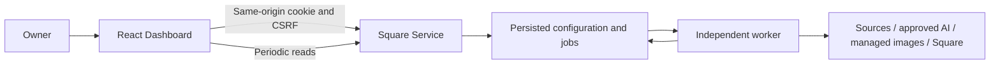
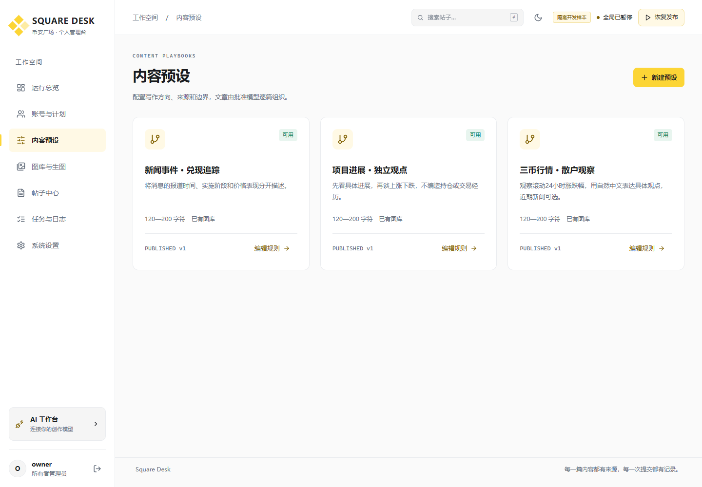
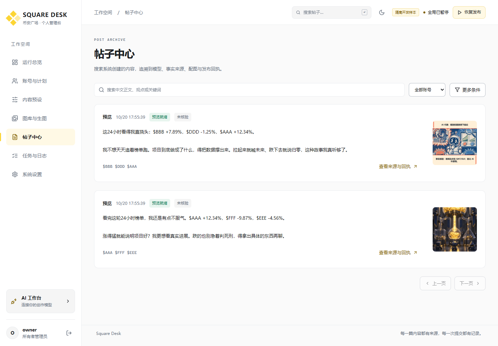

# Square Dashboard

**Current monorepo entry (2026-10-22):** [complete English guide](../../README.en.md), [中文](../../README.md), [20 production screenshots](../../docs/product/README.md). All 13 browser tests pass. Older component screenshots use isolated development fixtures; current production images live in root `docs/product/`. Older counts and deployment boundaries below are historical.

**v0.2.0** · Binance-inspired light/dark workspace and configurable AI providers, protocols and defaults. See [AI integration](docs/ai-integration.md).
Browser console for managing one owner's Binance Square accounts, provider keys, weighted content presets, independent randomized schedules, images, post history and publication failures. It uses the separate `square-service` backend through same-origin requests or a configured API origin; scheduling is persisted on the server and continues independently of the browser.

[中文说明](README.md) · [Interface and development checks](docs/interface-and-checks.md)

**2026-10-22 bulk import update:** Paste one API key per line; names and UIDs are not required. Blank lines are ignored and per-row results retain original line numbers. The build, 11 existing browser checks and the new import check pass; production desktop/mobile verification passed. See the parent project's `docs/13-key-only-account-import.md`.

**2026-10-22 source update:** The source workspace now shows Jinse, BlockBeats and Binance cards, actual read status, complete flashes, keyword/token/age filters, original evidence links, spot rankings and pair search. The build and all 11 browser tests pass, with production login and actual source reads verified. See the parent project's `docs/12-sources-and-market-upgrade.md`. Earlier counts and deployment boundaries below are historical records.

**2026-10-22 deployment update:** Set `window.__SQUARE_CONFIG__.apiOrigin` in `public/app-config.js` at deployment time to use a separate API hostname without rebuilding. Requests include credentials, including protected images. The build and 9 browser tests pass, covering cross-origin login, session restoration, images and logout. Actual deployment and the owner-managed API proxy are recorded in the parent project's `docs/11-remote-deployment.md`; the original v0.2.0 evidence below describes the earlier development stage.

## Pages and behavior

| Page | Functionality |
| --- | --- |
| Overview | Global pause, independent account schedule lanes, worker heartbeat, separate confirmation/verification/unknown status metrics |
| Accounts | Add/import, tags, disable/archive, key rotation, interval bounds, pause/resume/resample, weighted preset bindings and effective probabilities, manual execution |
| Presets | Direction, tone, length, tags, token selection, material, sources, image strategy, model parameters and quality controls; drafts, immutable versions, differences and previews |
| Media | Upload local files, controlled server-side import, collections/tags/style/reuse windows, approved GPT Image 2 jobs and results |
| Posts | Chinese substring search, combined account/token/preset/version/model/source/time/status filters, stable pagination, content/source/receipt detail |
| Jobs | Pipeline states, event timeline, redacted raw failures, actual rendered prompts and evidence; safe retries, cancellation, AI revision and read-only reconciliation |
| Settings | Provider/protocol selection, model discovery/registration/approval, default text/image routes, sources, runtime controls and audit records |




## Actual running screenshots

These were captured from the running UI and API on this workstation using explicitly labeled isolated development fixtures. They contain no real credentials, real AI calls or actual publications. Desktop viewport: 1440×1000; mobile: 390×844. [capture.json](docs/screenshots/capture.json) records capture time and browser errors.





The [screenshot directory](docs/screenshots/) also includes media, jobs, settings, rendered prompts and a mobile view. Images are existing local assets or fixture images, not evidence of real generation capability.

## Stack and structure

React 19, TypeScript, Vite, Lucide and native CSS, with no remote fonts or frontend provider keys. The lockfile pins the dependency graph. Requires **Node.js 22.14+** and npm; no Docker/WSL.

`src/main.tsx` contains login, navigation, overview and global controls. `src/pages/` covers accounts, presets, content and settings. `api.ts` manages same-origin requests/CSRF/errors, and `components.tsx` supplies labeled fields, dialogs, status badges and timelines. CSS provides a neutral/yellow light and dark visual system with responsive behavior. `tests/` contains Playwright flows; `scripts/` contains the fixture launcher and screenshot capture.

Persisted per-account next-run times are central to the design. Status labels explain control outcomes. Tables scroll within small screens instead of overflowing the document. Fields have associated labels, native dialogs manage focus, and the interface supports keyboard navigation and reduced-motion preferences.

## Connect the normal backend

Initialize and start the API in the separate backend repository first. Then run here:

```powershell
npm ci
npm run dev
```

Open `http://localhost:4300`. The default development proxy forwards `/api` to `http://127.0.0.1:4310`; override it with:

```powershell
$env:API_PROXY_TARGET='http://127.0.0.1:4310'
npm run dev
```

The backend `PUBLIC_ORIGIN` must match the exact browser origin; do not interchange `localhost` and `127.0.0.1`. Create the administrator through backend `npm run init`. There is no built-in production password.

The browser stores the theme preference in localStorage and uses a session cookie for authentication. Provider/Square keys are not stored in localStorage or frontend configuration; entry forms clear after submission, and subsequent reads are masked. Authentication, encryption, scheduling and publication gates run on the backend.

## Build and same-origin delivery

```powershell
npm run check
npm run build
```

The static output is `dist/`. The backend can host it through `WEB_DIR`; a future native web server may instead serve it and proxy `/api`. Remote servers cannot read a user's computer paths, so local images use the upload workflow.

This delivery did not deploy to a remote server or start a real publisher. Domain/TLS configuration, supervision and formal business acceptance are outside its scope.

## Isolated workbench and browser checks

Run `npm run workbench` in the backend repository, which opens its loopback fixture API on port `4321`, then run here:

```powershell
npm run workbench
```

Open `http://localhost:4300`, with fixture login `owner / fixture-password-1234`. The isolated temporary database and loopback HTTP fixture provide invented responses and hard-disable real publication. The header identifies the fixture profile. Stop both processes with Ctrl+C. Standalone clones also work; optional legacy `imagegen/` images are loaded only when that directory exists.

```powershell
# Keep a newly installed browser inside this repository:
$env:PLAYWRIGHT_BROWSERS_PATH="$PWD/.browsers"
npx playwright install chromium
npm test
# Or use an existing Chromium executable:
$env:PLAYWRIGHT_CHROMIUM_EXECUTABLE='<local chromium executable>'
npm test
node scripts/capture.mjs
```

**Eight browser development flows passed**: accounts and schedules, search and prompt lineage, resources, model discovery and defaults, provider protocols, connection creation and key rotation, persistent themes, and mobile focus/layout. `node scripts/audit-ui.mjs` checks seven pages at four widths in both themes: 56 combinations, with no page errors, document overflow or tested text-contrast issues. This automated development check is not a complete accessibility audit. Tests and capture close their pages and browsers. Temporary browser files are under `test-results/`; screenshots are under `docs/screenshots/`.

## How product constraints appear in the UI

An account may bind several presets. Only eligible published, enabled, model-backed presets with positive weight participate. Draft edits do not alter a running task's frozen version. Refreshing the page does not resample next-run times.

AI revision submits editing instructions and creates a new model-authored content version. The UI has no arbitrary text-to-publication bypass. All outgoing final text requires actual call evidence; failures do not trigger locally assembled template posts.

Ambiguous submission is a distinct status with constrained actions. Read-only reconciliation requires an original post ID and checks the original result. Unconfirmed outcomes remain blocked. Verification failure never triggers a duplicate submission.

## Limits and maintenance

Type checks, production builds and isolated browser flows are complete; they are not remote deployment or formal acceptance. Native PostgreSQL multi-process behavior, real provider/image/Square endpoints and rate limits still need target-environment verification. Overview/admin resource lists target personal usage, with no large-scale capacity claim; post searching runs in backend SQL.

The frontend/backend boundary is `/api/v1`; see the backend README for operating semantics. Change the requirements and backend constraints before adding new UI business rules. These are independent local Git repositories, with no configured public remote or push. No open-source license is attached.
