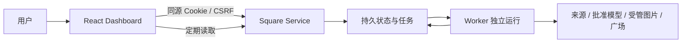
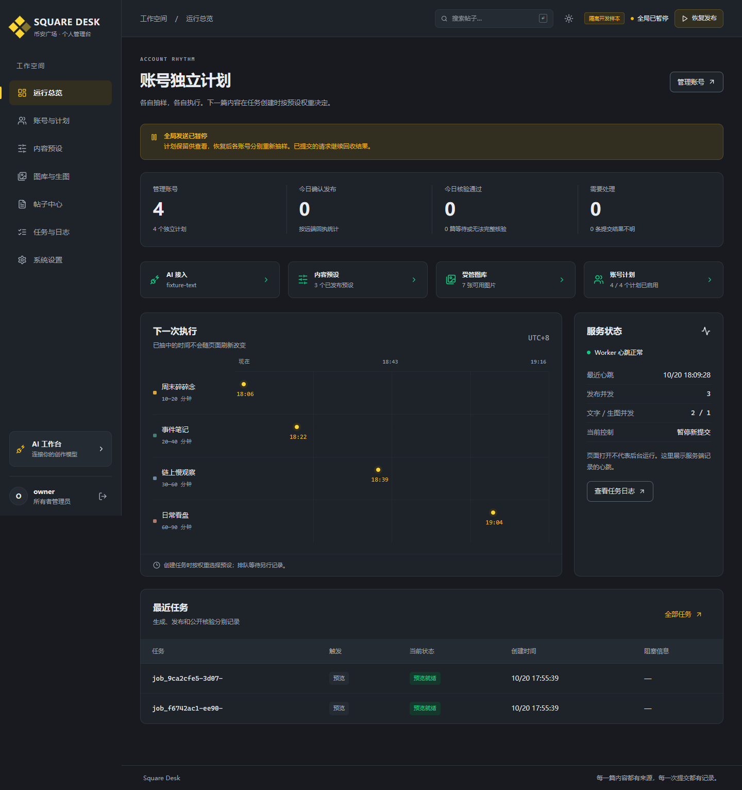
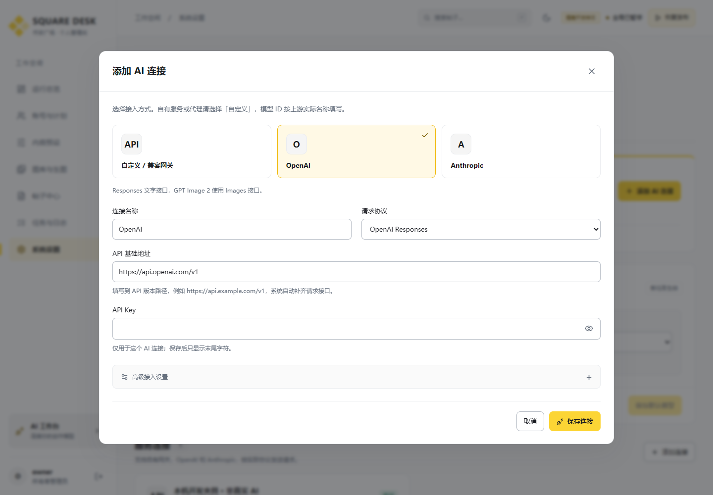

# Square Dashboard

**统一仓库当前入口（2026-10-22）**：[完整中文指南](../../README.md) · [English guide](../../README.en.md) · [20 张真实生产截图](../../docs/product/README.md)。当前 13 项浏览器测试通过；组件内旧截图为隔离开发夹具，最新生产截图位于根 `docs/product/`。以下旧测试数量和部署状态作为历史记录保留。

**2026-10-22 账号保存回归**：新增真实跨域浏览器检查，覆盖账号预设权重的 `PUT` 保存、重开持久化及原值恢复；后端已补齐预检允许方法。详情见项目根目录 `docs/15-account-bindings-cors-fix.md`。

**v0.2.0** · 币安风格明暗主题与完整 AI 接入配置。参阅 [AI 接入说明](docs/ai-integration.md)。
面向个人币安广场多账号管理的浏览器控制台。管理账号与 Key、加权内容预设、独立随机计划、图库、生图任务、帖子档案以及发布故障。前端通过同源或配置的独立 API 域名调用 `square-service` 后端，业务调度始终由后端持久执行。

[English README](README.en.md) · [界面与检查说明](docs/interface-and-checks.md)

**2026-10-22 批量导入更新**：每行粘贴一个 API Key 即可，无需名称或 UID；自动忽略空行，按原始行号显示成功、重复和错误。构建通过，原有11项浏览器检查及新增导入检查均通过；生产桌面与移动界面已验证，详见项目根目录 `docs/13-key-only-account-import.md`。

**2026-10-22 来源升级**：素材与新闻来源页面已补齐金色、律动、币安现货的来源卡片、真实读取状态、新闻正文、关键词/币种/时效筛选及原文证据；现货支持涨跌榜和交易对搜索。构建及 11 项浏览器测试通过，已登录生产环境验证两家新闻和行情读取；详见项目根目录 `docs/12-sources-and-market-upgrade.md`。下方较早的检查数量与部署边界为历史记录。

**2026-10-22 部署补充**：`public/app-config.js` 的 `window.__SQUARE_CONFIG__.apiOrigin` 可在部署时配置独立 API 地址，无须重新编译；请求携带会话，受保护图片使用相同地址。本次构建及 9 项浏览器测试通过，包含跨域登录、会话恢复、图片与注销。实际部署和待配置 API 代理见项目根目录 `docs/11-remote-deployment.md`；下方 v0.2.0 原有检查是此前开发阶段记录。

## 页面与核心行为

| 页面 | 功能 |
| --- | --- |
| 总览 | 全局暂停、账号独立计划时间线、Worker 心跳；分别显示发布确认、核验和提交不明 |
| 账号与计划 | 添加/导入、标签、停用/归档、Key 轮换；间隔上下限、暂停/恢复/重抽、多预设权重、有效概率、手动执行 |
| 内容预设 | 方向、口语风格、长度/标签/选币、素材与数据源、图片策略、模型参数、质量检查；草稿与发布版本、差异、预览 |
| 图库与生图 | 本机文件上传、受控服务器目录导入、集合/标签/风格、复用窗口；批准的 GPT Image 2 请求及状态 |
| 帖子中心 | 中文正文搜索，账号/币种/预设/版本/模型/来源/时间/状态筛选、稳定分页；正文、图片、来源与回执 |
| 任务与日志 | 流水线状态、时间线、原始去敏错误、实际完整 prompt、事实与 AI 证据；安全重试/取消/AI 修改/只读对账 |
| 系统设置 | 服务商与协议选择、模型发现/登记/批准、默认文字和图片模型、数据源、并发/禁词、密码与审计 |




## 真实运行截图

截图来自本机实际运行的前后端，使用明确标记的隔离开发样本；没有真实 Key、真实 AI 调用或真实发布。桌面视口 1440×1000，移动视口 390×844。采集时间与浏览器错误记录见 [capture.json](docs/screenshots/capture.json)。







图库、生图、模型设置、实际提示词和移动端截图见 [截图目录](docs/screenshots/)。图片为截图使用的已有本地素材或测试图片；不是生图能力证明。

## 技术与目录

React 19、TypeScript、Vite、Lucide 图标；原生 CSS，无远程字体或前端密钥。`package-lock.json` 固定依赖图。需要 Node.js **22.14+** 和 npm，不使用 Docker/WSL。

```text
src/main.tsx          登录、导航、总览、全局控制
src/pages/            账号、预设、内容资源、设置
src/api.ts            同源 API、CSRF、错误与时间格式
src/components.tsx   可访问表单、对话框、时间线与查询状态
src/style.css        主题变量、基础组件与响应式布局
src/workspace.css    币安式黑灰/黄色工作台、AI 接入与明暗模式
tests/               Playwright 开发流程检查
scripts/             隔离样本连接、真实截图采集
docs/                交互图、截图、检查说明
```

界面将“已抽样的账号下一次计划”作为核心信息。状态标签、错误和按钮解释操作效果；桌面表格在小屏幕内横向滚动，页面不整体溢出。表单提供关联标签，原生对话框管理焦点，支持键盘操作和减少动画偏好。

## 连接常规后端

先在独立的 `square-service` 仓库初始化并启动 API，再在本仓库运行：

```powershell
npm ci
npm run dev
```

默认浏览器地址 `http://localhost:4300`，开发代理转发 `/api` 到 `http://127.0.0.1:4310`。其他后端地址可设置：

```powershell
$env:API_PROXY_TARGET='http://127.0.0.1:4310'
npm run dev
```

后端 `PUBLIC_ORIGIN` 必须匹配浏览器实际访问源；`localhost` 和 `127.0.0.1` 不混用。管理员账号在后端 `npm run init` 创建，前端没有内置生产密码。

浏览器在 localStorage 保存主题偏好；鉴权依赖会话 Cookie。不把广场/模型 Key 写入 localStorage 或前端配置。Key 表单提交后清空，后续查询仅显示掩码。鉴权、加密、调度和发布约束由后端执行。

## 构建与同源交付

```powershell
npm run check
npm run build
```

产物为 `dist/`。可由后端设置 `WEB_DIR` 托管，或由未来服务器的原生静态服务托管并代理 `/api`；远程浏览器不能直接读取你的电脑路径，应使用上传功能把图片送到服务器图库。

本次没有部署到远程服务器，也没有启动正式发布器。正式域名、HTTPS、进程管理和业务验收不属于本轮。

## 隔离开发样本与浏览器检查

在后端仓库运行 `npm run workbench`（回环 API 端口 `4321`），随后在本仓库运行：

```powershell
npm run workbench
```

打开 `http://localhost:4300`，样本账号 `owner / fixture-password-1234`。这是独立临时数据库和本机 HTTP 夹具；真实发布硬关闭。界面会显示“隔离开发样本”。结束时分别 Ctrl+C 关闭两个进程。独立克隆也可运行，只有原项目存在 `imagegen/` 时才额外加载其中图片。

```powershell
# 安装浏览器到项目内目录；已有 Chromium 可通过下一项指定。
$env:PLAYWRIGHT_BROWSERS_PATH="$PWD/.browsers"
npx playwright install chromium
npm test
# 或使用现有可执行文件：
$env:PLAYWRIGHT_CHROMIUM_EXECUTABLE='<本机 chromium 可执行文件>'
npm test
node scripts/capture.mjs
```

**8 项浏览器开发检查通过**：账号和独立计划编辑、正文检索与完整提示词追溯、预设/图库/模型资源、模型发现及默认配置、服务商协议切换、连接新增与 Key 替换、明暗主题持久化、移动导航焦点和窄屏布局。另用 `node scripts/audit-ui.mjs` 检查 7 页 × 4 屏宽 × 2 主题，共56组，无页面错误、整页横向溢出或受测文本对比度问题；它是开发自动检查，不等同完整可访问性审计。浏览器测试和采集脚本均在结束时关闭页面与浏览器。测试临时目录在仓库 `test-results/`，截图保存到 `docs/screenshots/`。

## 产品规则在界面中的表达

每个账号绑定多个预设，只有已发布、启用、模型有效且权重大于零的候选参与抽样；编辑草稿不会覆盖已在运行的任务。随机计划显示服务器已持久化的抽样值，不会因刷新页面而变化。

“AI 修改”提交修改要求并创建新的模型成稿版本；没有可以绕过 AI 直接填正文发布的输入框。所有已发送正文必须关联实际调用证据。生成失败不会由浏览器拼接模板补发。

提交不明显示为单独状态，只有符合后端规则的操作可用。只读对账要求原帖 ID，检查原结果；无法确认时保留阻塞。公开核验失败不会触发重复发送。

## 当前限制与维护

已完成类型检查、生产构建和上述隔离浏览器流程检查；这不等同于远程部署或正式验收。原生 PostgreSQL 多进程、真实模型/生图/广场端点与频率上限需在目标环境核对。概览和管理资源列表适合当前个人管理规模，未承诺大规模容量；全文查询已在后端 SQL 执行。

前后端 API 以 `/api/v1` 为边界，详细运行约定见后端 README。新增业务规则先更新项目需求文档与后端约束，再更新界面。两个仓库是独立本地 Git 仓库，未推送或配置公开远端；未附加开源许可。
