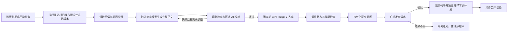

# Square Service

**统一仓库当前入口（2026-10-22）**：[完整平台中文指南](../../README.md) · [English guide](../../README.en.md) · [最新产品截图](../../docs/product/README.md)。当前后端 61 项测试通过，生产使用 `publish_first`，内容性问题记提示。下方旧阶段的严格校验、测试数量及未部署边界保留为历史说明，以根指南与 [最新变更](../../docs/17-publication-validation-and-priority.md) 为准。

**v0.2.0** · 币安风格明暗主题与完整 AI 接入配置。参阅 [AI 接入说明](docs/ai-integration.md)。
币安广场个人多账号管理平台后端。提供管理 API、账号独立随机调度、AI 内容流水线、受管图库、发布回执和公开核验。对应前端仓库为 `square-dashboard`。

[English README](README.en.md) · [运行与 API 说明](docs/runtime-and-api.md) · [检查记录](docs/development-checks.md)

**2026-10-22 账号保存修复**：跨域白名单补齐 `PUT`，使账号预设绑定和随机周期保存可通过浏览器预检；允许方法的检查与响应头共用同一份列表。构建及54项后端测试通过，并验证跨域浏览器保存、重新打开后的权重持久化；详见项目根目录 `docs/15-account-bindings-cors-fix.md`。

**2026-10-22 批量导入更新**：导入每条仅需 `apiKey`，名称自动生成，其他资料可选；保留逐条错误隔离与默认暂停。构建及53项后端测试通过，已部署并核验生产接口，详见项目根目录 `docs/13-key-only-account-import.md`。

**2026-10-22 来源升级**：已接入金色财经完整快讯，以及律动官方 RSS/公开频道/原文读取；保留实际取材方式、日期和证据。修复币安大响应失败并支持官方市场数据备用域名，新增来源状态、共享缓存和材料搜索 API。构建与 52 项后端测试通过，生产读取已验证；详见项目根目录 `docs/12-sources-and-market-upgrade.md`。下方较早的检查数量与部署边界为历史记录。

**2026-10-22 部署补充**：支持独立前端域名的受限 CORS 预检和凭据请求，保留 Origin、会话与 CSRF 校验。本次构建及 44 项后端测试通过。当前项目的实际远程部署与待配置 API 代理见项目根目录 `docs/11-remote-deployment.md`；下方 v0.2.0 原有检查是此前开发阶段记录。

## 实现范围

| 能力 | 行为 |
| --- | --- |
| 账号与凭据 | 稳定账号 ID、标签、导入、启停、归档、Key 轮换、重复凭据检测；数据库 AES-256-GCM 加密，查询只返回掩码 |
| 多预设 | 结构化草稿、不可变发布版本、一个账号多个加权绑定；记录候选、权重、概率、抽样值与所选版本 |
| 独立调度 | 每账号分别持久化上下限、抽样间隔、起点与下一次时间；整数秒均匀抽样，含上下限 |
| 文字 | 明确登记并批准的模型生成完整成稿；保存实际请求地址、连接/凭据版本、完整 prompt、参数、请求/返回模型标识、输出和摘要；无本地正文回退 |
| AI 接入 | OpenAI / Anthropic / 自定义连接、三种实际文字协议、只读模型发现、默认文字/图片模型；创建任务时固定实际选择 |
| 内容质量 | 字数、标签、行情数字、引用证据、禁词、结构相似度校验；默认另调用 AI 校对，失败只交回 AI 有限修复 |
| 图片 | 本机上传/受控导入的已有图片，或批准的 GPT Image 2 请求；先持久入库并检查字节、摘要、来源、比例，再发送 |
| 行情与新闻 | 币安现货滚动 24h 数据及备用域名；金色与律动近期快讯、真实读取方式、北京时间及引用证据，支持来源状态、共享缓存与材料搜索；可选来源无法核实则省略并记录 |
| 发布与恢复 | 同账号活动任务互斥、持久租约与执行代次、提交意图、全局/账号最终闸门；结果不明隔离，不自动重发 |
| 查询与追溯 | 中文正文子串、多条件搜索、稳定游标；帖子关联任务、模型调用、图片、事实快照、校验、回执与核验 |




## 运行环境与目录

Node.js **22.14+**、npm；远程运行采用原生 PostgreSQL，开发可用内嵌 PGlite。无需 Docker/WSL。锁文件固定本次实际安装的依赖版本。

```text
src/          API、领域控制、调度、流水线、外部适配与查询
database/     SQL 表、索引、关系和不可变记录约束
scripts/      初始化、离线迁移、构建、隔离开发样本
tests/        HTTP/API/领域/流水线回归检查
docs/         逻辑图、真实运行截图、API 与检查说明
data/         本地数据库、受管图片、迁移报告（不进 Git）
```

## 本机开发

在本仓库目录运行：

```powershell
npm ci
Copy-Item .env.example .env
node -e "console.log(require('crypto').randomBytes(32).toString('base64'))"
```

把生成值填入 `.env` 的 `ENCRYPTION_KEY`，设置至少 12 字符的 `ADMIN_PASSWORD`。不要把密钥值写进文档或提交到 Git。`DATABASE_URL` 留空使用单进程 PGlite；默认数据在 `data/`。

```powershell
npm run init
npm run dev
```

API 默认 `127.0.0.1:4310`，前端开发地址 `http://localhost:4300`。新系统全局暂停，新账号计划暂停，`SQUARE_PUBLISH_ENABLED=false`。普通开发流程不会发送真实帖子。管理员初始化只允许首次执行，不覆盖现有密码。

## 与前端组合

前端构建后可以由 API 以同源方式托管。以下是运行入口说明，本仓库交付未执行远程部署：

```powershell
npm run build
# .env: WEB_DIR=../square-dashboard/dist
# 同源运行时 PUBLIC_ORIGIN 必须与浏览器实际访问的源完全一致。
npm start
```

`DATABASE_URL` 配置 PostgreSQL 后支持独立 API/Worker；API 设置 `RUN_WORKER=false`，Worker 使用同一数据库、加密主密钥和受管图片目录，另运行 `npm run worker`。PGlite 只能由一个进程持有，不可据此启动第二个 Worker。远程域名、HTTPS、服务管理、备份和数据库容量留给部署阶段。

## 配置与首次业务准备

完整环境变量见 [.env.example](.env.example)。`PUBLIC_ORIGIN` 用于写请求 Origin 检查；会话采用 HttpOnly Cookie 和 CSRF。HTTPS 运行配置 `COOKIE_SECURE=true`。`OUTBOUND_PROXY_URL` 为显式 HTTP 出站代理；不隐式读取旧项目认证。

在 Dashboard 中依次登记模型连接、批准实际模型 ID、准备图库、发布预设版本、录入账号并绑定多个正权重预设，配置独立随机间隔。文字连接通过 OpenAI 兼容 `/chat/completions`，例如由你指定的 `gpt-6-luna`；生图通过 `/images/generations`，必须登记为 GPT Image 2 系列。基础地址、认证、实际 ID、参数兼容性由连接配置决定，程序不声称网关返回的模型名称能证明内部权重。

连接检查只读取 `/models`，不代表生成能力已验证。广场缺少已验证的只读凭据校验接口时返回 `verification_unsupported`，不会通过试发来测试 Key。实际发布传输需要运行环境明确启用，并通过运行控制恢复；这两项控制互相独立。

“三币行情与律动新闻、120—190 字优先、不超过 200 字”是可编辑示例；其他预设可使用固定币种或主题、不同长度和取材。全平台保留正文禁用“情绪”字样、不得编造交易/内幕、AI 成稿与图片来源要求。

## 调度和错误处理

- 启用/恢复：`当前时刻 + U(min,max)`。确认发布：`确认时刻 + U(min,max)`；公开核验等待不阻塞下一次计划。
- 修改区间保留当前已抽样时间；只有显式重新抽样才改变。停机错过的未认领计划跳过并分别重抽，不集中补发。
- 同一账号一次一条活动发布流水线；同一任务的重试保留预设版本。模型/取材在提交前允许有限退避；认证拒绝、提交超时、限流不会被盲目重复提交。
- 全局暂停阻止新的真实提交；单独暂停某账号计划仍允许手动任务，停用/归档/凭据失效/提交不明则禁止。
- `submission_unknown` 保留提交意图并阻塞该账号。可以提供原帖 ID 做只读对账：要求正文、标签、图片关联匹配，账号有 UID 时还检查作者；不会因此重新发帖。无法匹配则保留阻塞。
- `published` 表示平台发布确认；`verified` 表示公开正文、标签和图片关联均已匹配。远端图片 URL 无法关联时显示 `unavailable`，不虚报通过。限流遵守 Retry-After；没有有效值时采用一小时冷却。

## 离线旧数据迁移

```powershell
npm run migrate:legacy -- --source <旧项目目录>
# 阅读 dry-run 报告后，明确需要时再使用：
npm run migrate:legacy -- --source <旧项目目录> --apply
```

迁移器读取旧账号/Key、`imagegen/` 和可识别发布历史，报告保存在 `data/migration-reports/`；不会启动 Worker 或调用发布/模型接口。迁入账号暂停。缺少 AI 证据的历史标记 `legacy_unverified`，不能当作合格成稿重发。本次开发未导入现有真实 Key。

## 检查与隔离样本

```powershell
npm run check
npm run build
npm test
npm run workbench
```

后端 **43 项开发回归检查通过**。Workbench 使用独立数据库、回环 HTTP 夹具、虚构账号和响应，端口 `4321`；硬关闭真实发布。登录样本 `owner / fixture-password-1234` 只在这个隔离样本中存在。它用于前端开发与截图，不能当成真实 AI 调用或生产发布记录。结束时 Ctrl+C 关闭。

实机截图来自本机实际运行的 Dashboard 和本后端，数据为上述隔离样本；不是设计稿。


## 当前验证边界

已完成代码、构建、隔离 HTTP/数据库检查和浏览器开发流程检查。未进行远程部署、正式业务验收、原生 PostgreSQL 多进程压力检查、真实模型计费调用或真实广场发送。目标服务器系统/规模、实际 GPT Image 2 服务协议及广场当前能力仍需在目标环境核对。新闻解析和 AI 校对有局限，来源变化会导致停止或省略可选新闻，而不是补造事实。

两个仓库是独立本地 Git 仓库，未配置远端、推送或发布。使用和分发权限由项目所有者决定；未附加开源许可。
