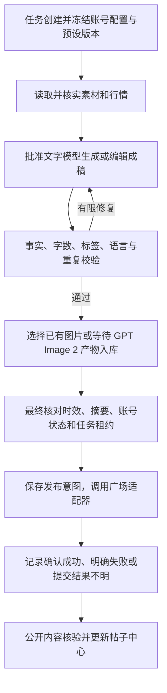

# 03 · 内容预设、AI 生产与发布关口

## 不可绕过的发布条件

最终文字有批准模型的成稿证据；全部图片有合法来源且已在图库落盘；事实和规则校验针对当前内容通过；账号与计划允许提交；任务未确认发送过、未处于提交结果不明状态。

这些条件由后端统一执行。Dashboard、定时器和任何内部 API 都只能申请任务，不能直接把任意字符串交给广场上传发布适配器。

## 文字生成和编辑

首个文字连接沿用 `gpt-6-luna` 的已用方案，但端点、凭据引用和批准模型由服务配置管理。用户所说“等具体 AI 模型”落实为明确的模型注册与批准名单，不接受任意名字就自动替代默认模型。

每个文字版本保存：任务、输入事实/参考资料、规则和预设版本、完整渲染提示词、请求的模型名、响应报告的模型名/请求 ID（若提供）、时间、参数、输出及校验结果。模型名不同或响应缺少标识时要明确记录，不能将“发送了 model 参数”当作已证明上游权重身份。

人工可以输入选题、原始材料、要求和修改意见。最终发送文字由模型生成或编辑后保存为不可变版本；管理员再修改正文、标题或需要发送的标签时，旧成稿证据失效，须重新调用模型处理。

对正文采用明确的规范化（如换行统一为 LF），在同一规范化文字上记录 `contentHash`。发布关口要求模型输出版本、最终版本、校验版本的摘要一致。格式修正、截断、拼接句子、手工换数字或后加标签都不能作为隐藏的发布前步骤。

不发送的后台备注、账号别名和检索标签不属于发布文字；不能借此将未经 AI 成稿的字段注入远端正文。

## 预设结构

| 分组 | 配置项与规则 |
| --- | --- |
| 版本 | `presetId`、版本号、草稿/已发布/停用状态、变更说明 |
| 文字模型 | 批准的模型引用、支持参数、超时和有限修复策略 |
| 内容 | 方向、主题选择、语言、视角、语气、观点范围、禁止内容 |
| 长度 | 优先区间与硬上限；按 Unicode code point 计数，包含空白、标签、标点和链接 |
| 标签 | 数量、来源、必要标签和位置偏好；非所有预设都必须三币 |
| 取材 | 数据源引用、来源优先级、必需/可选、字段/单位、时效和关联性 |
| 图片 | 图库模式/新生图模式/显式组合模式、集合和标签、风格、比例、数量、复用窗口 |
| 质量 | 全局禁词、预设禁词、事实检查、同账号/跨账号历史重复窗口、修复上限 |
| 缺失处理 | 必需素材缺失则阻塞；可选消息缺失时按声明省略，不能擅自补造 |

预设之间可以风格不同，但不包含固定成段正文模板。它规定边界、素材和目标，文章本身由 AI 独立组织。

首版建议默认一篇一图。图片数量最终受经验证的远端能力限制；不能直接把旧脚本能力声明当作远端接口最新承诺。

## 提示词组成与版本

提示词依次包含平台不变约束、预设版本规则、本次任务与输出协议、可引用事实、参考材料，以及仅用于去重的历史特征。明确事实数据和外部原文是输入材料，不能覆盖系统任务。

每次生成保存实际组合后的提示词及摘要，便于 Dashboard 查看和追溯。提示词文档与代码绑定版本；更新生产提示词不会改写历史请求记录。

现有用户明确要求正文不出现“情绪”及其派生词，作为继承的默认全局禁词。其他历史黑名单与套句检查需要区分硬性禁止和质量提示：自然中文不能仅靠无限增加禁句清单定义。

同质化检查同时覆盖关注点、结论、常用开头收尾和结构；过滤币名、数字后仍高度相似的文章不能仅以“模型生成过”放行。允许把历史文本作为去重参考，禁止仿写成模板。

## 新闻与行情

优先读取与选题直接相关的原文；记录 URL、标题、报道时间、事件时间、抓取时间、可核实事实、单位和关系。新闻摘要必须能追溯到已读取正文，不能只凭搜索摘要、导航/推荐栏的币名匹配或新闻标题就认定事实。

具体预设决定是否必须新闻、优先 BlockBeats 还是其他来源，以及近72小时/7天等窗口。必要来源不可用则阻塞该任务；可选来源不可用可以省略并记录原因。

涨跌幅需要存储交易市场、交易对、统计窗口、快照时间及数值。校验对结构化事实进行绑定，识别标签对应的数字和方向，避免仅凭相邻文本正则把其他币的数字误认成该币事实。

消息与价格同向变化不直接写成因果；提案、测试、计划与已上线分别表达。行情过期时刷新相关事实，并让模型重新成稿，不能用字符串替换修正价格后直接发布。

## 图片来源与生图

远程服务器托管图库接收两类来源：用户上传/迁入的已有图片、批准 `GPT Image 2` 模型任务返回并完整入库的图片。发布只引用 `assetId`，不接收任意外部图片 URL 或用户电脑绝对路径。

已有图片保存原始来源类型、导入批次、文件内容摘要、尺寸/格式、集合、风格标签和使用记录。重复文件可以共用实体，保留不同引用；文件缺失或损坏时不可发布。

生图任务保存批准的模型引用、完整提示词、参数、预设、请求/响应标识、状态、产物和用量（如提供）。逻辑名称 `GPT Image 2` 的实际 API 模型 ID、参数和调用方式需要在目标连接上验证；不能自动换其他生图模型。

生成结果要先保存为服务器受管文件、校验格式和尺寸、计算摘要，再登记为 Asset。若模型返回临时下载地址，由后端通过该服务连接允许的地址获取，不能将临时地址当持久图库资产。

选图可以按集合、标签、比例和最近使用窗口随机。符合条件的图库为空时，按预设选择阻塞或创建生图任务；只有预设明确配置才能回退到其他图库或图片来源。新图生成超时不伪装为成功，结果不明时先查询原任务，避免重复计费。

## 执行顺序

图文可以在有独立输入时并行准备；最终关口必须核对二者属于同一任务版本。等待生图导致行情过期时返回取材和 AI 成稿步骤。

## 发布与核验状态

任务阶段：`queued → preparing → generating_text → validating → preparing_media → ready → submitting → published`。根据阶段可进入 `retry_wait`、`failed`、`blocked` 或 `cancelled`；提交结果不明进入 `submission_unknown`。

核验是独立字段：`not_started / pending / verified / mismatch / unavailable`。接口明确返回帖子 ID 后即为已确认发布；公开读取延迟不修改为发送失败，也不能因此重发。

核验比较正文、必要标签和图片数量/内容关系。远端若转换图片，比较可验证的远端媒体关联，而非要求上传前后文件字节完全相同。任何未能完成的比对项都要标明，不能笼统写“全部通过”。

若超时、连接中断或服务重启发生在发布提交后，系统优先核对回执和远端记录。外部接口未提供幂等保证时，不承诺网络条件下严格 exactly-once；通过本地防重、发布意图和结果不明隔离降低重复提交。
