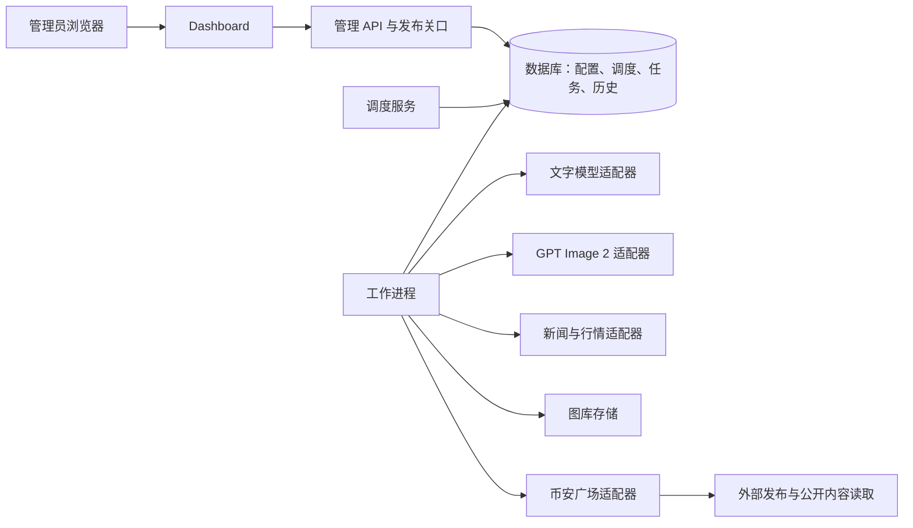

# 05 · 系统架构、数据实体与迁移

## 部署基线

已确认远程服务器部署。首版建议单部署实例、单管理员、持久化数据库、后台工作池和服务器托管图库。浏览器是控制端；服务无需控制端常开。

复用现有 Node.js 经验，建议新业务采用 TypeScript/Node.js；关系型数据库建议 PostgreSQL，作为账号、任务、配置版本和持久化调度的事实来源。此为建议架构，具体版本、前后端框架和服务器系统在开发前确定。

本地不使用 Docker、WSL 或其他虚拟化环境；首版部署方案也不依赖容器，可用目标系统原生服务管理器启动 API、调度器和工作进程。目标系统尚未确定时，不把 Windows BAT 当作远程 Linux 的部署入口。

## 组件职责



| 组件 | 职责 |
| --- | --- |
| 管理 API | 登录、配置、搜索、任务申请、版本冲突处理；不把 Key 返回给列表 |
| 调度服务 | 发现到期账号、事务认领、随机间隔和预设选择、重启恢复 |
| 工作进程 | 按持久化任务执行取材、AI、配图、校验、发布与核验 |
| 发布关口 | 唯一的外部发送入口；核对内容证据、资产、租约、控制状态与幂等 |
| 模型适配器 | 服务连接、模型能力、请求/响应、超时、用量与状态查询 |
| 数据适配器 | 来源正文、事实快照、时效、单位、关联与读取错误 |
| 广场适配器 | 密钥注入、图片上传与发布回执；公开核验与能力声明分离 |
| 数据库 | 可事务更新的状态与检索；存引用和元数据，不存明文凭据到历史任务 |
| 图库存储 | 完整实体图片、摘要与受管路径；生成临时 URL 不是持久资产 |

首版可将逻辑组件部署在同一台服务器，但保留独立工作进程和重启边界。数据库持久任务表可先承担队列；是否引入独立消息服务取决于容量评估，不作为首版前置依赖。

## 推荐代码布局

```text
app/
  web/                  Dashboard
  server/               管理 API、认证和发布关口
  worker/               调度、执行、核验工作进程
  domain/               账号、预设、任务、内容与校验规则
  adapters/             文本、图片、新闻行情、币安广场
  database/             表结构、迁移、查询与事务
  contracts/            API 数据结构与验证定义
  deploy/               原生服务、环境样例、备份恢复与部署入口
  data/                 新平台本地持久数据挂载点，排除源码版本管理
  src/                  现有原型，迁移期间保留
docs/                    需求、设计、验收与变更记录
```

此目录是建议，不在需求整理阶段创建空壳工程。现有根目录脚本可先经适配器调用；所有新增开发与配置进入 `app/`。

## 主要实体

| 实体 | 主要字段 | 关键约束 |
| --- | --- | --- |
| `admin_users` | ID、登录标识、密码摘要、会话状态 | 首版仅所有者管理员，远程访问需认证 |
| `accounts` | ID、名称、平台 UID、标签、状态、controlVersion | 内部 ID 稳定，不以 Key 或数组顺序作为主键 |
| `credentials` | ID、所属对象、类型、加密密文/秘密引用、指纹、版本、状态 | 广场与模型凭据分离，查询返回掩码 |
| `model_connections` | ID、端点、协议类型、凭据引用、健康和并发设置 | 连接中无固定于源码的真实 Key |
| `models` | ID、连接、逻辑名、实际模型名、text/image、能力状态 | `gpt-6-luna` 和 GPT Image 2 分开注册 |
| `presets` | ID、名称、当前已发布版本、状态 | 已被任务引用的预设不可破坏历史 |
| `preset_versions` | ID、预设、版本、完整规则、摘要、发布时间 | 已发布版本不可变 |
| `account_presets` | 账号、预设、权重、启用、变更版本 | `(accountId,presetId)` 唯一；有效权重合计大于0 |
| `schedules` | 账号、上下限、nextDueAt、anchorAt、抽样值、版本、启停 | 每账号一条当前调度，原始抽样进入事件记录 |
| `publication_jobs` | ID、账号、触发来源、预设版本、阶段、租约、控制版本、nextRetryAt | 同账号活动发布任务互斥；外部幂等键可去重 |
| `generation_runs` | 任务、text/image、请求模型/响应模型、提示词、请求标识、用量、状态 | 输入输出不包含发布 Key；记录有限重试尝试 |
| `content_versions` | 任务、最终文字、字符数、标签、contentHash、成稿记录引用 | 版本不可变；人工变更后重新成稿 |
| `source_snapshots` | 来源、URL、读取/事件/报道时间、事实、单位、有效期 | 内容版本关联使用的实际快照 |
| `content_sources` | 内容版本、来源快照、引用事实、关联币种 | 多对多关系，一篇可引用多条来源，一条来源可供多篇使用 |
| `assets` | ID、来源、storageKey、fileHash、类型、尺寸、标签、生成任务、状态 | 只允许两类已批准来源；文件持久可读 |
| `job_assets` | 任务、资产、位置、实际上传结果 | 保存图片顺序和使用关系 |
| `validation_runs` | 内容/图片/事实摘要、规则版本、错误和警告、时间 | 放行版本必须与发送版本一致 |
| `publish_attempts` | 任务、attemptId、凭据版本、提交意图、阶段、回执、外部 ID | 不记录完整 Key；未知结果不能直接新建重发 |
| `posts` | ID、任务、账号、内容版本、远端 ID/链接、确认时间、发布状态 | 远端 ID 在确认前可为空；已确认后对应一次发布业务结果 |
| `verification_runs` | 帖子、读取状态、文字/标签/图片结果、原始错误 | 核验状态不覆盖发布事实 |
| `task_events` | 任务/账号、时间、阶段、原因、耗时、追踪 ID | 可搜索，敏感字段移除 |
| `audit_events` | 操作者、动作、目标、前后版本、时间、请求 ID | 记录启停、Key 轮换、预设变更与手动执行 |

实际 SQL、字段类型、索引及约束由数据库迁移文件落实；本表是领域模型，不声称已建表。

## 必要的数据一致性

调度认领、创建任务和账号活动占用应在同一数据库事务里完成。租约用递增标记隔离过期执行者，提交时重查控制版本；前端的重复点击保护不替代数据库约束。

发布意图须先持久化，再调用外部服务。外部服务成功但本地保存前崩溃时进入结果不明恢复流程。数据库事务不能包住网络副作用并自动消除这种不确定性。

平台 Key 用服务端密钥材料保护，列表只显示掩码；备份同时规划数据库、图库与解密材料的独立保管。凭据指纹用于去重而非显示完整 Key；相同用户拥有的 Key 轮换与账号身份确认仍需明确映射。

## 搜索与索引

首版实现结构化过滤和中文连续子串查询：账号、预设、模型、状态、代币、来源、创建/发布时间。按 `(createdAt,id)` 等稳定键分页；时间和常用过滤列建立索引。

中文分词、语义搜索和相似检索不是首版关键词搜索的隐含依赖。数据规模明确后再决定子串索引/专用搜索服务，按验收数据实测，不能只凭英文全文检索配置宣称中文搜索完成。

## 远程服务与运行

Dashboard 和 API 通过同站点 HTTPS 入口访问，工作进程和数据库不直接暴露管理接口。日志使用请求/任务追踪 ID，原始错误去除凭据后可在 Dashboard 追溯。

服务管理器负责 API、调度器和工作进程的重启与心跳。停止服务、重新部署和全局暂停具有不同含义；滚动更新前先阻止新提交，收集在途结果，再交接租约。

持久存储容量、备份频率、留存时间、并发和告警渠道待确认。健康页至少检查 API、数据库、调度心跳、工作进程心跳、图库可读写及连接状态。

## 现有程序差距与迁移

| 现状及依据 | 可利用部分 | 新平台需要补齐 |
| --- | --- | --- |
| `app/src/index.mjs` 使用统一 `setInterval` 和批次流水线 | 取材、模型、校验、发布步骤经验 | 账号独立持久计划、任务状态与租约 |
| `app/src/config.mjs` 固定模型与连接 | 明确默认模型及禁止模板回退 | 数据化连接、批准模型和能力配置 |
| `app/src/llm.mjs` 在代码中拼接提示词 | 生成/修复请求结构 | 预设版本、实际提示词和内容版本证据 |
| `app/src/validation.mjs` 包含三币/200字和正则 | 基础校验思路 | 规则按预设驱动、结构化事实、全历史去重 |
| `app/src/news.mjs` 基于公开页面与宽泛相关匹配 | 公开读取连接 | 正文定位、项目别名匹配、关系核验与可选降级 |
| `square-batch.mjs` 与 `vendor/square-post/` | 上传发布与回执基础 | 统一关口、账号级任务、能力与限额验证 |
| `verify-post.mjs`、`verify-batch.mjs` | 公开核验思路与历史记录 | 独立核验任务、并发写入一致性与逐项结果 |
| `keys.txt`、批次 JSON、runs 文件 | 既有凭据及历史迁移来源 | 数据库归一化、稳定账号 ID、秘密隔离 |
| 根目录 `imagegen/` | 现有图片 | 远程图库入库、来源与使用映射 |
| BAT/PowerShell watchdog | 本地运行入口 | 远程原生服务部署与运维 |

迁移顺序：建立稳定账号 → 安全导入凭据与人工核对身份映射 → 图库登记 → 历史内容/回执导入 → 示例预设 → 默认暂停的账号计划。生成迁移报告和去重映射；迁移不触发发布。

历史记录缺少模型证据时标为 `legacy_unverified`，不能补造 generation 记录。它们可以搜索和追溯原始来源；重新发送必须走新的 AI 成稿任务。

目标服务器不能沿用本机私有代理地址或 Windows 绝对路径。网络、凭据、存储和模型端点在远程部署时分别配置，发布切换前解决旧进程与新平台双重调度。
