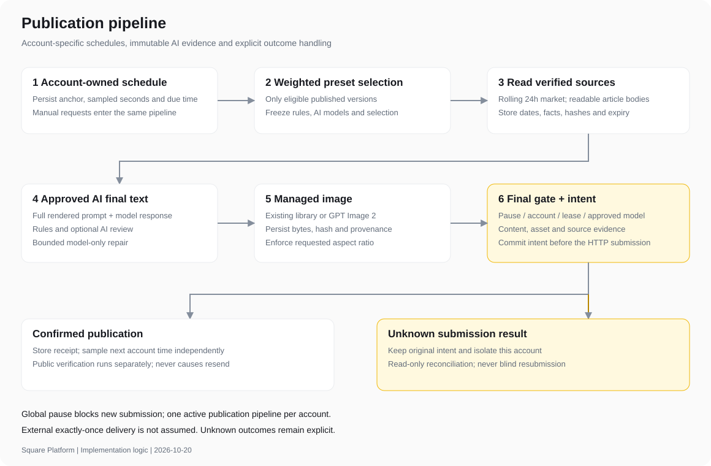
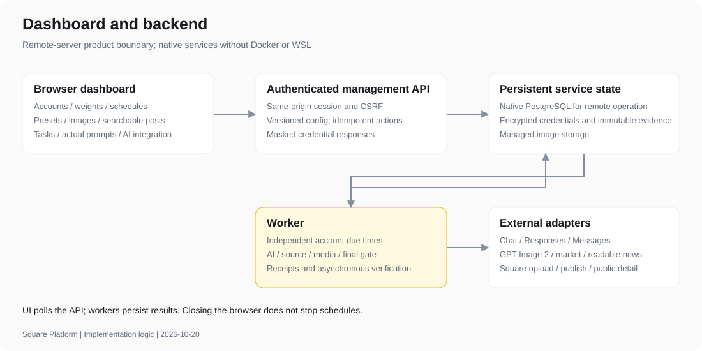
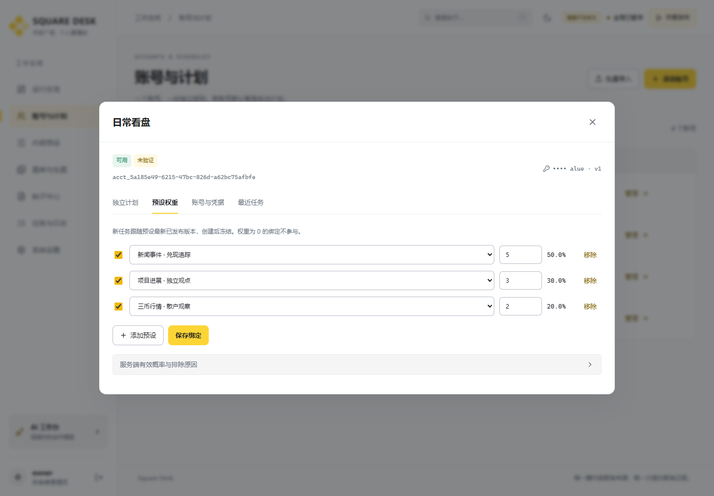

# 开发记录 / Development record

> 本页记录 v0.1.0 初次交付。后续升级见 [Dashboard 与 AI 接入升级](10-dashboard-and-ai-upgrade.md)；共享截图目录随最新版本更新，初始截图保留在两仓库的 v0.1.0 标签中。

本轮范围：依据 00—08 文档开发平台、建立独立 Git 仓库、补齐中英双语说明、逻辑图和本机运行截图。远程部署和正式验收不在本轮范围内。

## 仓库与边界

- `app/square-service`：TypeScript API、持久任务、账号调度、模型与广场适配、资料取材、图库、数据库迁移、开发测试。
- `app/square-dashboard`：React/TypeScript 管理界面，通过同源 `/api/v1` 调用后端。
- 原 `app/src` 为旧批量程序，保留供迁移对照。新系统不启动旧发布器，也不自动导入或启用旧账号。

## 实现决策

- 远程运行以 PostgreSQL 为数据层；开发提供同 SQL 的 PGlite 单进程模式，无 Docker/WSL。PGlite 进程拥有数据库，开发时 API 与 Worker 在同进程；独立 Worker 仅用于 PostgreSQL 模式。
- 数据库事务、账号级互斥、持久租约和提交意图共同防止重复发送；提交结果不明时隔离，不盲目重试。
- 模型端点、实际模型 ID 与凭据由设置管理。示例预设引用 `gpt-6-luna`，新生图仅接受明确登记并批准的 GPT Image 2 模型；不推断未提供的服务能力。
- 默认全局暂停、新账号调度暂停；开发检查使用隔离数据库与本机测试服务，不调用真实发布接口。
- 视觉方向：冷灰底、深蓝文字、琥珀控制色；各账号已抽样的独立计划作为总览的核心信息。界面区分已发布、核验、失败和提交不明。

第三方实现依据：[PGlite](https://pglite.dev/docs/)、[node-postgres 事务](https://node-postgres.com/features/transactions)、[Fastify](https://fastify.dev/docs/latest/Reference/Server/)。

## 本次开发交付

日期：2026-10-20。版本：0.1.0。此记录描述代码与开发检查；按用户要求未执行远程部署及正式验收，不将 07 中的全部 AC 标为已验收。

| 仓库 | 中文说明 | English | 主要入口 |
| --- | --- | --- | --- |
| `app/square-service` | [README](../app/square-service/README.md) | [README.en](../app/square-service/README.en.md) | `src/main.ts`、`src/worker-main.ts` |
| `app/square-dashboard` | [README](../app/square-dashboard/README.md) | [README.en](../app/square-dashboard/README.en.md) | `src/main.tsx` |

两者各自拥有独立 `.git`、锁文件、忽略规则与本地提交，不使用根目录作为包含凭据的整体仓库。Git bundle 和校验清单在 [development/releases](development/releases/)。没有配置远端或执行推送。

本地提交：后端 `c245c45`，前端 `90762c6`，均标记 `v0.1.0`。完整提交、包大小、SHA-256 和检查摘要见 [交付清单](development/releases/manifest.json)。

## 原始需求到实现

本实现于创建持久任务的事务内抽样并冻结预设版本，Worker 认领时沿用；排队后的新预设发布不会改变既有任务。每次模型调用保存当时的请求 URL、连接版本与凭据版本引用，后续修改连接不会覆盖历史地址。

| 需求 | 实现位置 | 已完成的开发行为 |
| --- | --- | --- |
| R-01 · AI 成稿 | service `ai.ts`、`validation.ts`、`pipeline.ts`；Dashboard 预设/任务页 | 批准模型、实际请求地址与连接/凭据版本、完整消息/参数/请求与返回模型 ID、不可变成稿、摘要最终闸门；无本地正文回退；AI 修改与有限修复；默认额外 AI 校对 |
| R-02 · 已有图库或 GPT Image 2 | service `media.ts`、`ai.ts`；Dashboard 图库/生图/预设页 | 上传与受控路径导入；标签/风格/集合/复用；批准图片模型请求；持久字节/来源/摘要/实际比例检查；超时结果不明不重放 |
| R-03 · 多账号 Key | service `control.ts`、`core.ts`、`server.ts`；Dashboard 账号页 | 单所有者会话、CSRF/Origin、Key 加密/掩码/去重/轮换、稳定 ID、导入与归档；不以试发校验 Key |
| R-04 · 帖子管理搜索 | service `queries.ts`、`server.ts`；Dashboard 帖子/任务页 | SQL 中文子串、条件 AND/字段值 OR、稳定游标；预览/失败/已发状态、来源和完整提示词追溯；发布确认与公开核验分离 |
| R-05 · 多风格预设 | service `rules.ts`、`control.ts`；Dashboard 预设页 | 结构化草稿/发布版本/差异/预览；内容、长度、素材、来源与图片/模型参数可配；平台规则保留，旧三币规则为示例 |
| R-06 · 独立随机计划 | service `control.ts`、`pipeline.ts`、SQL 约束；Dashboard 账号/总览页 | 每账号含端点均匀秒级抽样、持久起点/间隔/下次时间；多预设正权重选择并保存概率/抽样/版本；租约与账号互斥；重启不补发积压 |
| 多账号故障与未知结果 | service `pipeline.ts`、`square.ts` | 持久提交意图；明确失败隔离、限流冷却；结果不明不盲目重发；提供原帖 ID 做只读对账，不触发新发送 |
| 远程产品边界 | API 同源静态入口、PG 模式、浏览器上传 | 支持 API/Worker 分离及共享受管存储；浏览器不承担计时器。目标服务器部署仍未执行 |
| 旧数据迁移 | service `scripts/migrate-legacy.ts` | 默认 dry-run，显式 apply，暂停迁入账号，旧历史无模型证据标 `legacy_unverified`；本次未导入真实数据 |

## 运行逻辑和实机截图

截图是本机实际运行的 React UI + Fastify API，使用显式隔离数据库、回环 HTTP 夹具与虚构账户；界面标记“隔离开发样本”，真实发布关闭。不是设计稿，也不证明真实模型或生产发布已经运行。采集时间、视口、页面错误清单见 [capture.json](development/screenshots/capture.json)。完整 10 张截图在前端仓库 `docs/screenshots/`，后端仓库亦包含相关截图。

本轮截图与检查结束后，已关闭本轮启动的 4300/4321 临时开发服务与浏览器，没有保留后台发布任务。需要再次查看样本时，按文末的 Workbench 入口启动。

逻辑图有 SVG 与 README 中可编辑 Mermaid；重建 SVG 和同步截图使用 `python docs/development/build-diagrams.py`，不会连接发布服务。

## 开发检查结果

| 范围 | 执行方式 | 结果 |
| --- | --- | --- |
| 后端类型与构建 | `npm run build` | 通过，含 SQL 资产复制 |
| 后端回归 | `npm test` | **35 通过，0 失败** |
| 前端类型与生产构建 | `npm run build` | 通过 |
| 浏览器开发流程 | 隔离 Workbench + 原生 Chromium + Playwright `npm test` | **4 通过，0 失败** |
| 实机截图 | `node scripts/capture.mjs` | 10 张，页面错误 0；结束关闭浏览器 |

后端覆盖会话/CSRF、凭据轮换、权重与版本冻结、互斥和幂等、独立计划、重启恢复、中文查询、模型失败无回退、禁词/事实/引用进度/相似度、图片来源与摘要/比例、最终暂停/轮换闸门、租约、明确拒绝、提交不明和只读对账、单账号失败不阻塞其他账号、PGlite 文件持久化。

检查发现并修复的具体问题包括：明确拒绝后图片预留未释放、缺少独立 HTTP 连接池导致夹具端口复用偶发失败、表单标签关联不完整，以及图片比例仅存元数据未验证字节。回归结果是修复后运行结果。

这些是开发回归检查，不声称已逐条执行全部正式 AC。原生 PostgreSQL 多进程竞争/压力、真实模型/生图/广场协议、服务器重启和备份恢复等仍需目标环境阶段执行。

## 已知边界与外部待定

1. 未部署远程服务器、未导入真实 Key、未进行真实计费模型或广场发送。旧程序保留，新的隔离开发入口不接管旧发布器。
2. PostgreSQL 远程运行适配已编码；本机没有原生 PG 实例，本轮 SQL/事务检查在 PGlite 执行，不替代多进程 PG 检查。PGlite 仅限单进程开发。
3. `gpt-6-luna` 与 GPT Image 2 的实际端点/模型 ID/允许参数由设置登记；网关响应模型名不能证明其内部模型权重。连接探测只读，不等于真实生成能力验收。
4. 广场上传/发布/公开读取适配已实现，但目标账号权限、频次、字段和图片 URL 关联仍需实际服务确认。服务无可验证的只读凭据检查时明确返回不支持。
5. 提交不明无法假定外部 exactly-once；保留账号阻塞并查询原结果。只读对账未匹配则不解除。图片 URL 被远端改写时公开核验可显示不可比，而非虚报通过。
6. 律动需可读取原文、日期与证据；解析失败时按必需/可选规则阻止或省略。规则校验和 AI 校对都不能保证发现所有事实/文风问题。
7. 管理列表及总览适用于当前个人平台规模，尚未承诺容量/时延；大规模检索、全量列表分页、留存、备份和服务器网络限制在后续容量/部署范围内明确。帖子查询已在 SQL 执行。

## 本地查看方式

真实业务配置按两个仓库 README 初始化，默认暂停。仅查看隔离样本时：后端仓库 `npm run workbench`，前端仓库 `npm run workbench`，访问 `http://localhost:4300`，示例登录 `owner / fixture-password-1234`。样本硬关闭真实发布，关闭时分别 Ctrl+C。

远程服务器的部署、正式验收和真实发布需要后续对应任务；本次不把启动本机开发样本视为完成远程部署。

## English handoff

Two independent local Git repositories implement the backend and browser dashboard. Each includes complete Chinese/English READMEs, editable logic diagrams and actual screenshots of the running fixture UI/API. Backend regression: **35 passed**; browser development flows: **4 passed**; both production builds passed.

Implementation covers approved-model final text with immutable call evidence, existing/GPT Image 2 media, encrypted account credentials, searchable content lineage, versioned presets, weighted per-account selection and independent persisted random schedules. Submission intent, lease fencing, final gates and explicit unknown-result isolation protect recovery; public verification and read-only reconciliation never trigger a resend.

This is development delivery, excluding remote deployment and formal acceptance. Native PostgreSQL multi-process/load behavior, real provider/image/Square compatibility, server operations and backup recovery remain target-environment work. Existing credentials were not imported and no real posts or billable model requests were sent.
