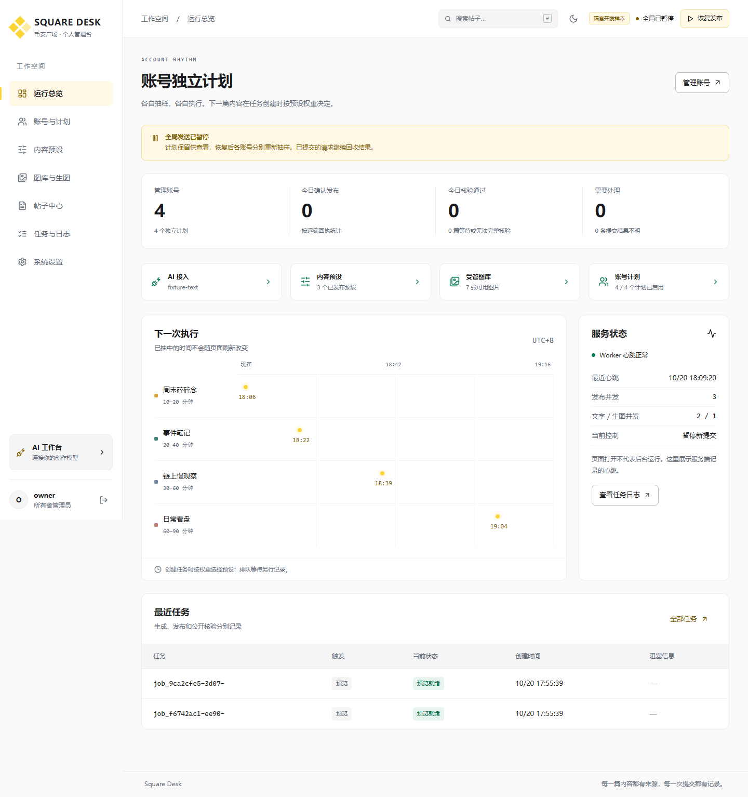
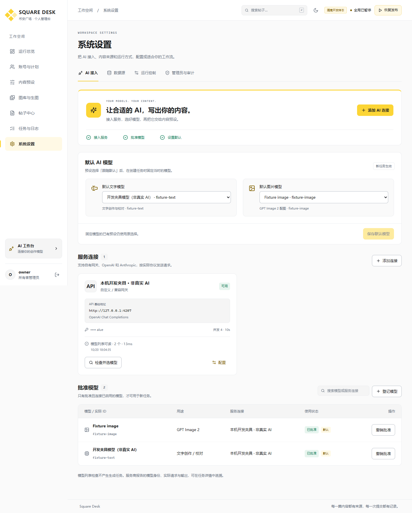
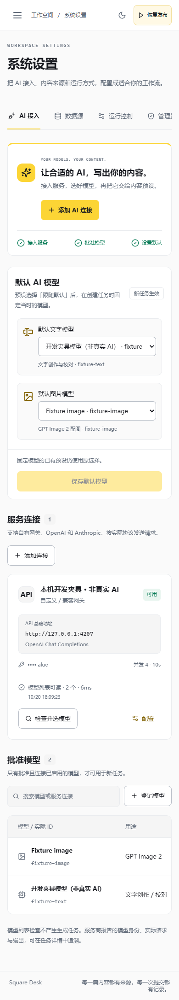

# Dashboard 与 AI 接入升级

本轮以远程服务器、单人管理多个个人币安广场账号为部署和使用基线。每账号绑定多个已发布预设，按权重抽样；随机发送计划继续由后端独立持久化执行。

## 视觉方向

参考币安公开产品的中性色、黄色主操作及金融信息层级。使用自有 Square Desk 标识，不宣称币安官方产品。浅色以白、浅灰、炭黑为主，深色以炭灰分层，黄色用于选中和主要操作，红绿只表达业务状态。使用中文系统字体、等宽数字、明确的表格和紧凑卡片，保留独立账号时间轨道作为总览特征。

所有页面共享导航、页头、表格、表单、空状态、错误反馈、对话框和焦点样式。移动端使用可关闭的抽屉导航；主题偏好可本地保存。搜索、键盘操作、加载和保存状态应有明确反馈。

## AI 接入流程

1. 选择 OpenAI、Anthropic 或自定义兼容网关，配置实际服务地址、请求协议、Key 和超时、并发等参数。
2. 只读检查模型列表，显示时间、耗时、发现数量或具体错误；手动模型 ID 仍可登记。模型列表可读不代表生成已验证。
3. 登记、批准实际模型。文字支持 Chat Completions、Responses、Messages；图片仍仅允许明确登记的 GPT Image 2 与 Images 协议。
4. 设置默认文字和图片模型。预设可固定模型或跟随默认设置；每次任务创建时解析并保存实际模型选择与默认设置版本。
5. 在预设中设置内容规则、来源、配图和质量约束，保存并发布版本，然后绑定账号。所有最终正文继续由实际 AI 请求生成和校对，运行记录保留实际请求体、提示词、地址、请求与报告模型、版本及输出。

新建、编辑、检查、登记与默认配置必须调用真实后端接口。开发验证只使用隔离的模拟服务，不导入现有账号 Key，不发送真实帖子，不调用计费模型。

## 官方接口依据

- [OpenAI 文本生成](https://developers.openai.com/api/docs/guides/text)
- [OpenAI Responses 迁移指南](https://developers.openai.com/api/docs/guides/migrate-to-responses)
- [Anthropic 创建消息](https://platform.claude.com/docs/en/api/messages/create)
- [Anthropic 模型列表](https://platform.claude.com/docs/en/api/models/list)
- [币安广场](https://www.binance.com/en/square)

## 实现与开发检查

版本：**0.2.0**，日期：2026-10-20。两个独立仓库完成了对应代码、配置界面和双语说明。新版总览提供接入就绪入口、账号独立计划时间线和完整 SQL 统计；帖子全局搜索、过时请求取消、表单结果反馈、移动抽屉焦点和主题保存也已接入。

| 检查 | 结果 |
| --- | --- |
| 后端回归 `npm test` | **43通过，0失败** |
| 前后端 `npm run build` | 均通过 |
| 实际 UI/API 浏览器流程 | **8通过，0失败** |
| 7页 × 4屏宽 × 2主题 | **56组**，页面错误0、整页横向溢出0、受测文本对比度问题0 |
| 实际运行截图 | **15张**，包括明暗、AI接入、模型发现和移动端 |

后端新增检查覆盖三种文字协议的实际 HTTP 请求/响应、认证、创作和校对、保留参数、不完整输出拒绝、模型发现、原子轮换、默认模型冻结、默认生图和总览统计。前端新增检查覆盖配置闭环、协议切换、默认模型持久化、连接编辑与密钥替换、主题与移动焦点。模型名按用户填写的实际 ID 发送，例如自有网关的 `gpt-6-luna`，不会换成显示名称或其他模型。

自动界面检查只覆盖可计算的文本对比度和指定页面状态，不等同完整可访问性审计。详细结果见 [界面检查](../app/square-dashboard/docs/interface-and-checks.md)、[后端检查](../app/square-service/docs/development-checks.md)、[AI 接入说明](../app/square-dashboard/docs/ai-integration.md)及[界面检查原始记录](development/checks/ui-audit.json)。

## 实际运行截图

截图来自原生 Windows 上运行的 React、API 和隔离 HTTP 夹具；不是设计稿。样本标记可见，真实发布硬关闭。采集清单见 [capture.json](development/screenshots/capture.json)，完整图片见[截图目录](development/screenshots/)。脚本结束关闭浏览器，不保留无用标签页。

## 交付与运行边界

前端和后端保持独立 Git 仓库，最新源码包、提交与摘要见[本地交付清单](development/releases/manifest.json)和[恢复说明](development/releases/README.md)。本轮未部署远程服务器，未导入真实账号凭据，未发送真实帖子或计费模型请求；原始批量程序保持原样。

目标服务器的原生 PostgreSQL 多进程、真实服务商模型权限/参数/限流、广场上传发布及公开核验仍需目标环境验证。回环夹具通过证明本实现按所测协议处理请求，不能证明外部账号已开通相应能力。接入界面明确区分“模型列表可读”和“生成能力已验证”。

可重新启动隔离样本：分别在 `app/square-service`、`app/square-dashboard` 执行 `npm run workbench`，打开 `http://localhost:4300`。详细生产初始化和远程运行边界按各仓库 README 执行。

本地交付提交：后端 `dba328c`，前端 `5605c8b`；均标记 `v0.2.0`。两个源码包已通过 Git 校验。本轮启动的4300/4321临时开发服务与浏览器已关闭。
