# 产品截图与技术图册 / Product and architecture gallery

[中文平台 README](../../README.md) · [English platform README](../../README.en.md) · [捕获清单 / Capture manifest](capture-manifest.json)

以下 20 张图片来自 2026-10-22（Asia/Taipei）实际线上管理台，不是设计稿或测试夹具。Capture used authenticated, read-only production navigation; counters may change between pages because background publishing continued.

凭据展示区域及密码输入框已遮挡。没有触发预览、发帖、核验、改权重或计划；脚本拦截除登录/注销以外的 API 写操作，并检查运行开关未变。The capture browser was closed in `finally`; no unused tabs were left running.

截图不含实际认证值。可见账号后缀、任务标识、统计、原文和回执属于当时真实产品状态。A confirmed receipt and public verification are distinct; the screenshots preserve both labels.

## 技术图 / Technical diagrams

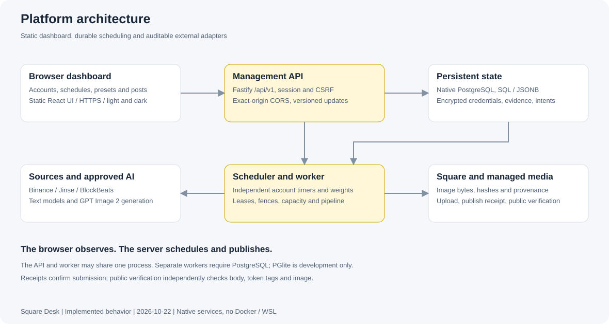

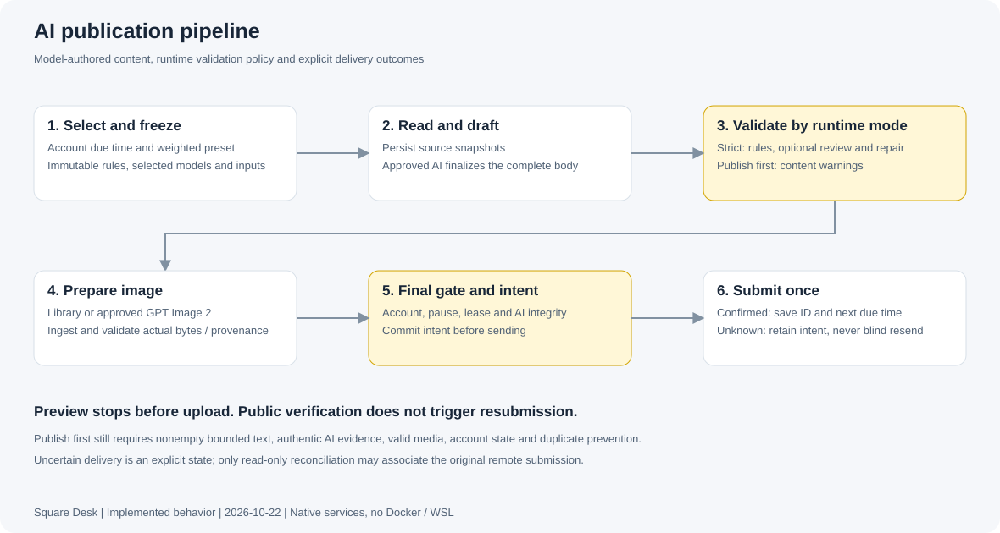

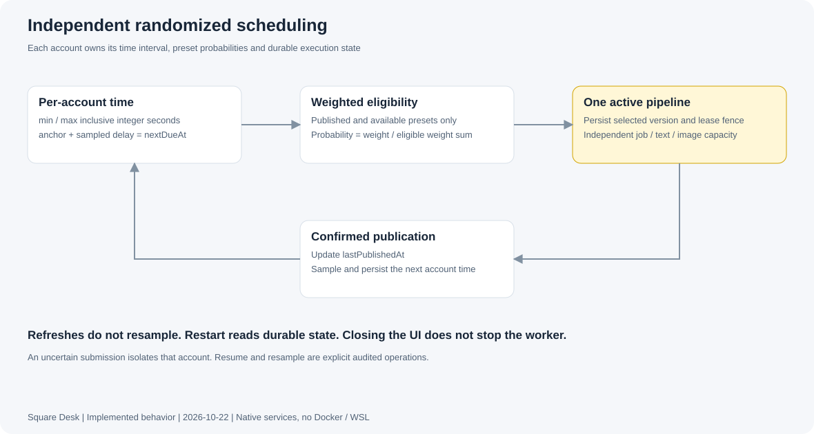

这三张 SVG 可直接查看或下载，源文件由 `app/repository/build-product-docs.py` 生成；中英文 README 另含可编辑 Mermaid 架构、流程、时序与实体关系图。

## 模块目录 / Module index

| # | 页面 / Module | 图片 / Image |
| --- | --- | --- |
| 01 | 管理员登录 / Administrator sign-in | [PNG](screenshots/01-login.png) |
| 02 | 生产运行总览（浅色）/ Production overview, light | [PNG](screenshots/02-overview-light.png) |
| 03 | 生产运行总览（深色）/ Production overview, dark | [PNG](screenshots/03-overview-dark.png) |
| 04 | 多账号与独立随机计划 / Accounts and independent schedules | [PNG](screenshots/04-accounts.png) |
| 05 | 账号随机周期与下一次执行 / Per-account random interval | [PNG](screenshots/05-account-schedule.png) |
| 06 | 多预设权重和有效概率 / Weighted preset bindings | [PNG](screenshots/06-preset-weights.png) |
| 07 | 只需 API Key 的批量导入（空表单）/ Key-only import, empty form | [PNG](screenshots/07-key-only-import.png) |
| 08 | 十种内容与生图预设 / Ten content and image playbooks | [PNG](screenshots/08-preset-library.png) |
| 09 | 内容预设与字数、文风约束 / Versioned content rules | [PNG](screenshots/09-preset-editor.png) |
| 10 | 预设配套的图片模型和风格 / Per-preset image generation rules | [PNG](screenshots/10-image-rules.png) |
| 11 | 真实发布记录与搜索 / Actual posts and search | [PNG](screenshots/11-posts.png) |
| 12 | 正文、配图、来源及发布回执 / Post, image, sources and receipt | [PNG](screenshots/12-post-detail.png) |
| 13 | 托管图库及 AI 配图 / Managed library and generated images | [PNG](screenshots/13-media-library.png) |
| 14 | 任务状态、排队与错误记录 / Job states, queues and errors | [PNG](screenshots/14-jobs.png) |
| 15 | 任务阶段时间线 / Per-job event timeline | [PNG](screenshots/15-job-events.png) |
| 16 | 明确的文字、图片模型与协议连接 / Explicit model and protocol configuration | [PNG](screenshots/16-model-connections.png) |
| 17 | 金色、律动与币安现货来源 / Jinse, BlockBeats and Binance spot sources | [PNG](screenshots/17-news-market-sources.png) |
| 18 | 并发、内容校验模式与 Worker / Runtime controls and worker | [PNG](screenshots/18-runtime-controls.png) |
| 19 | 移动端总览 / Mobile overview | [PNG](screenshots/19-mobile-overview.png) |
| 20 | 移动端账号 / Mobile accounts | [PNG](screenshots/20-mobile-accounts.png) |

## 01 · 管理员登录 / Administrator sign-in

路由 / Route: `/overview` · 1600 × 1050 viewport · light

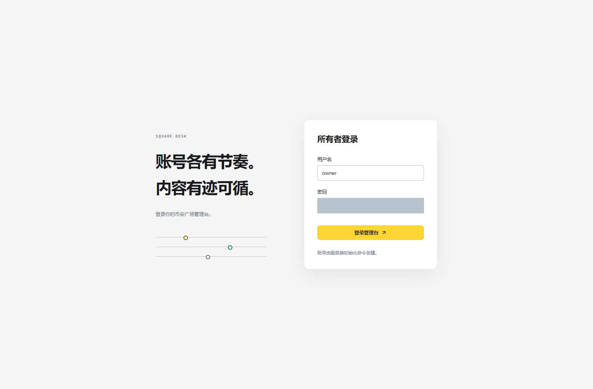

## 02 · 生产运行总览（浅色）/ Production overview, light

路由 / Route: `/overview` · 1600 × 1050 viewport · light

## 03 · 生产运行总览（深色）/ Production overview, dark

路由 / Route: `/overview` · 1600 × 1050 viewport · dark

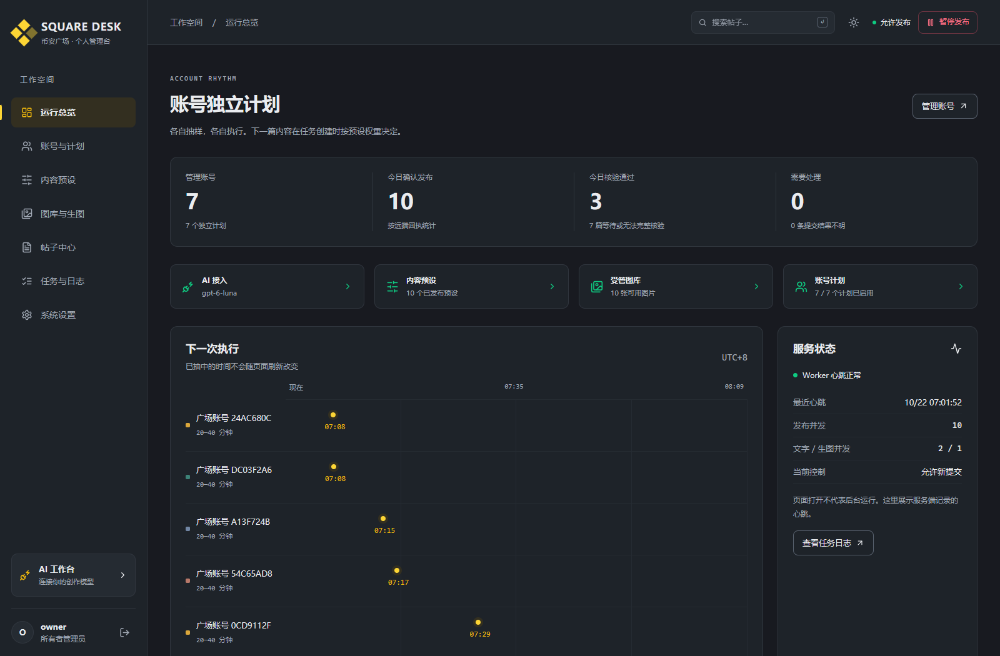

## 04 · 多账号与独立随机计划 / Accounts and independent schedules

路由 / Route: `/accounts` · 1600 × 1050 viewport · light

## 05 · 账号随机周期与下一次执行 / Per-account random interval

路由 / Route: `/accounts` · 1600 × 1050 viewport · light

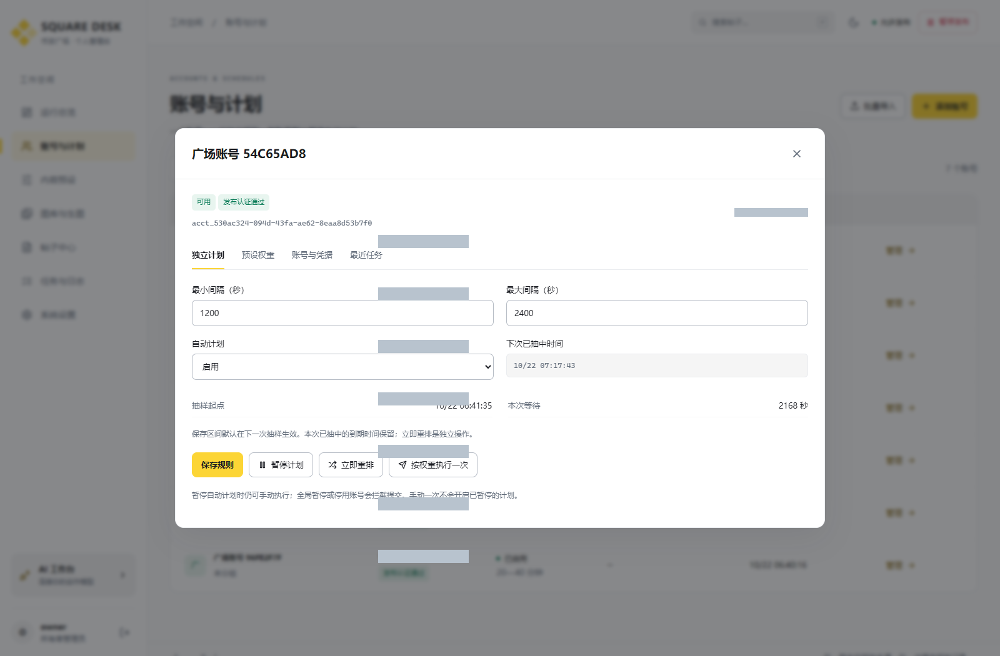

## 06 · 多预设权重和有效概率 / Weighted preset bindings

路由 / Route: `/accounts` · 1600 × 1050 viewport · light

## 07 · 只需 API Key 的批量导入（空表单）/ Key-only import, empty form

路由 / Route: `/accounts` · 1600 × 1050 viewport · light

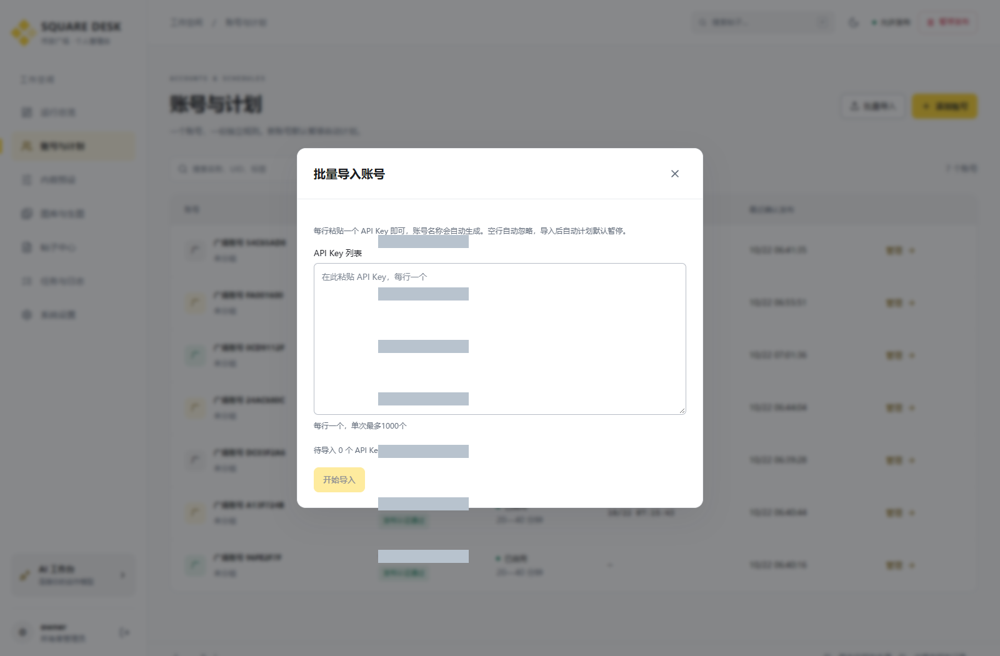

## 08 · 十种内容与生图预设 / Ten content and image playbooks

路由 / Route: `/presets` · 1600 × 1050 viewport · light

## 09 · 内容预设与字数、文风约束 / Versioned content rules

路由 / Route: `/presets` · 1600 × 1050 viewport · light

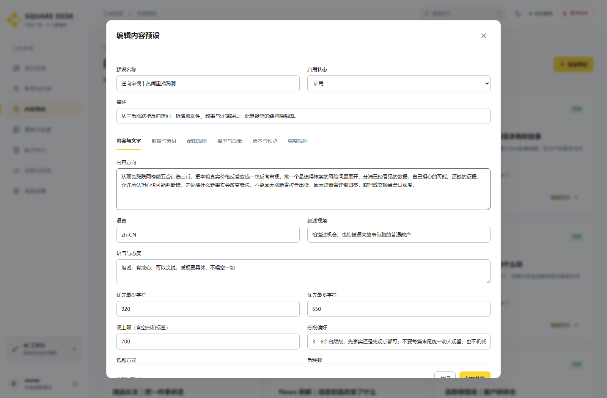

## 10 · 预设配套的图片模型和风格 / Per-preset image generation rules

路由 / Route: `/presets` · 1600 × 1050 viewport · light

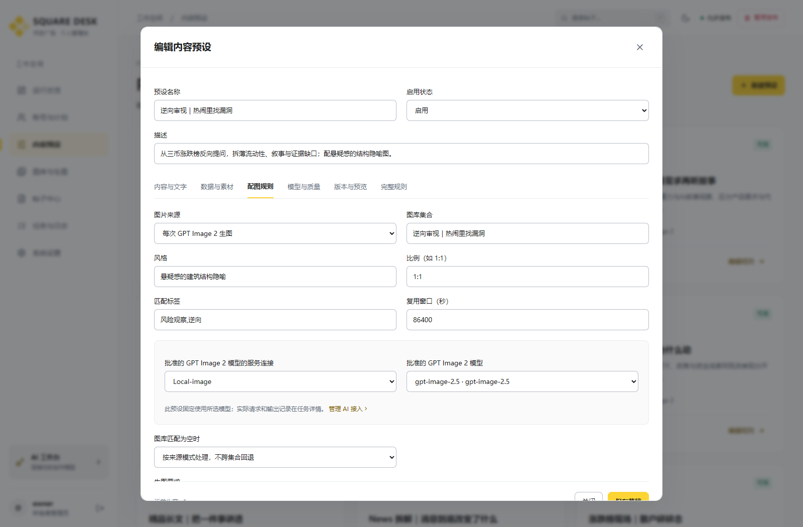

## 11 · 真实发布记录与搜索 / Actual posts and search

路由 / Route: `/posts` · 1600 × 1050 viewport · light

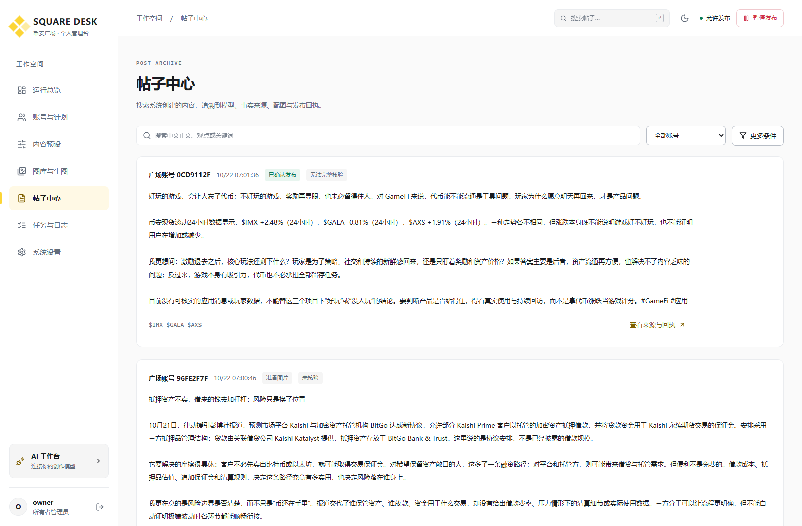

## 12 · 正文、配图、来源及发布回执 / Post, image, sources and receipt

路由 / Route: `/posts` · 1600 × 1050 viewport · light

## 13 · 托管图库及 AI 配图 / Managed library and generated images

路由 / Route: `/media` · 1600 × 1050 viewport · light

## 14 · 任务状态、排队与错误记录 / Job states, queues and errors

路由 / Route: `/jobs` · 1600 × 1050 viewport · light

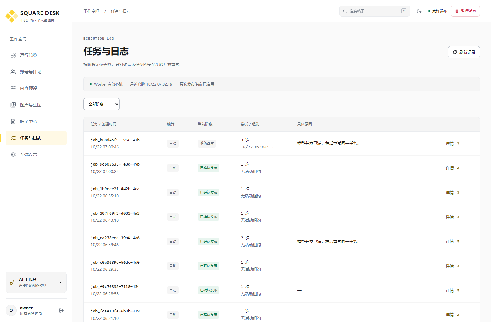

## 15 · 任务阶段时间线 / Per-job event timeline

路由 / Route: `/jobs` · 1600 × 1050 viewport · light

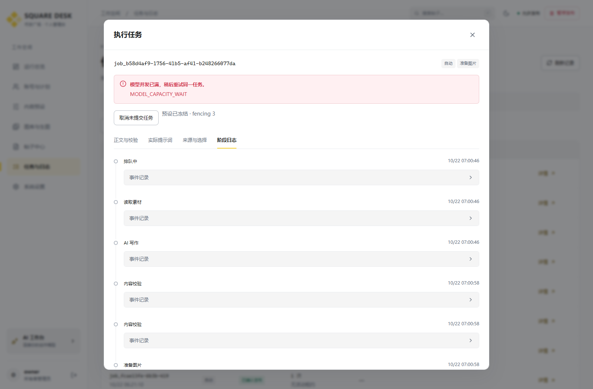

## 16 · 明确的文字、图片模型与协议连接 / Explicit model and protocol configuration

路由 / Route: `/settings?section=models` · 1600 × 1050 viewport · light

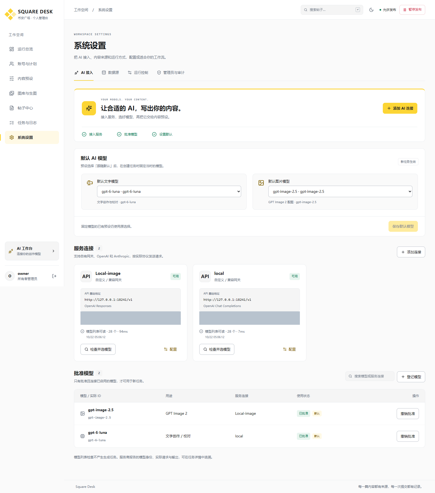

## 17 · 金色、律动与币安现货来源 / Jinse, BlockBeats and Binance spot sources

路由 / Route: `/settings?section=sources` · 1600 × 1050 viewport · light

## 18 · 并发、内容校验模式与 Worker / Runtime controls and worker

路由 / Route: `/settings?section=runtime` · 1600 × 1050 viewport · light

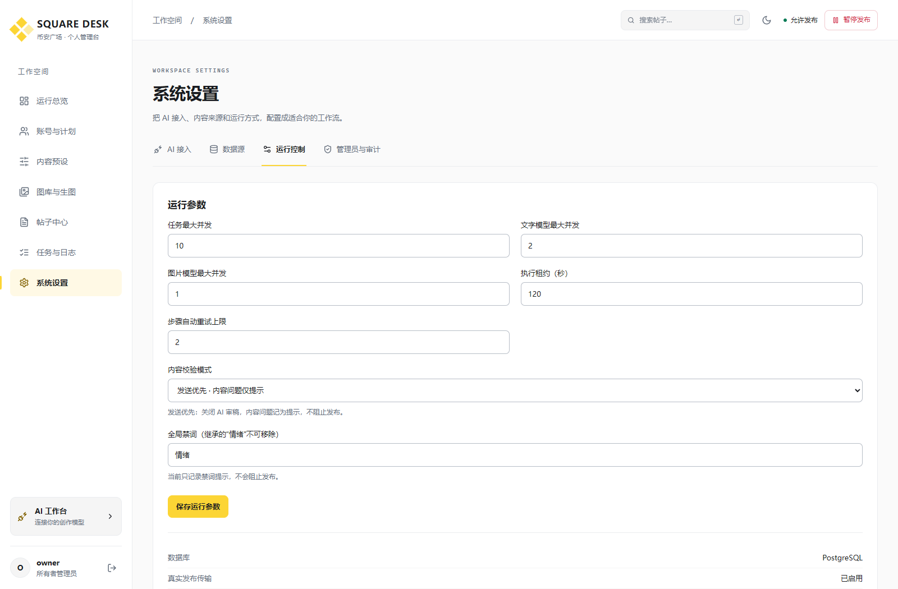

## 19 · 移动端总览 / Mobile overview

路由 / Route: `/overview` · 390 × 844 viewport · light

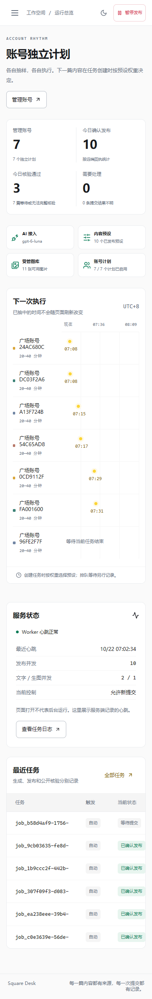

## 20 · 移动端账号 / Mobile accounts

路由 / Route: `/accounts` · 390 × 844 viewport · light

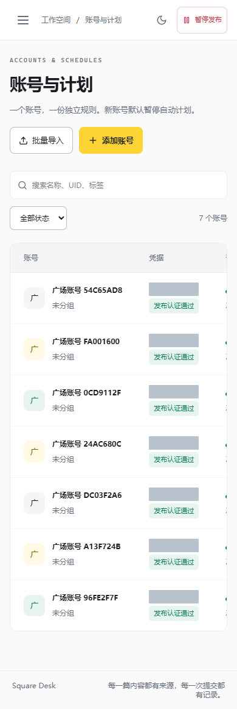
